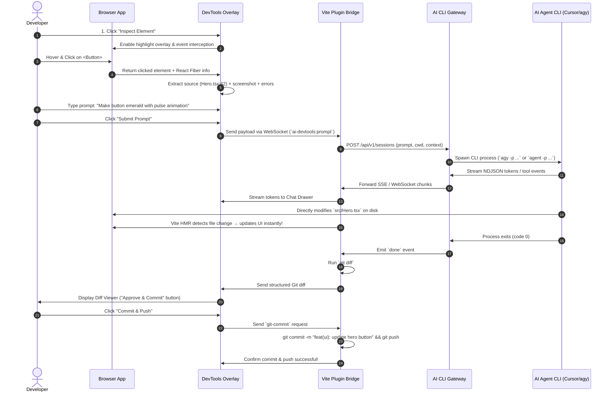

# AI CLI Gateway & Frontend DevTools Overlay — Master Implementation Plan

> **Target Implementer:** Grok 4.7 in Cursor  
> **Workspace:** `/Users/santi/dev/ai-cli-gateway`  
> **Author:** Antigravity  
> **Date:** October 2026  

---

## Table of Contents
1. [Executive Summary & Architecture Vision](#1-executive-summary--architecture-vision)
2. [Monorepo Architecture & Directory Structure](#2-monorepo-architecture--directory-structure)
3. [Project 1: AI CLI Gateway (`@gateway/core` & `@gateway/server`)](#3-project-1-ai-cli-gateway)
   - [3.1 CLI Adapter Abstraction](#31-cli-adapter-abstraction)
   - [3.2 Provider Implementations (Cursor, Antigravity, Claude Code, Codex)](#32-provider-implementations)
   - [3.3 Session Lifecycle & Process Manager](#33-session-lifecycle--process-manager)
   - [3.4 Streaming Protocol (SSE & WebSocket)](#34-streaming-protocol)
   - [3.5 REST & WebSocket API Specification](#35-rest--websocket-api-specification)
4. [Project 2: Frontend DevTools Overlay (`@devtools/overlay` & `@devtools/vite`)](#4-project-2-frontend-devtools-overlay)
   - [4.1 Architecture & Shadow DOM Isolation](#41-architecture--shadow-dom-isolation)
   - [4.2 Element Inspector & Source Code Mapping](#42-element-inspector--source-code-mapping)
   - [4.3 Context Engine (Errors, Console, Network, Screenshot)](#43-context-engine)
   - [4.4 UI Panels (Chat, Diff Viewer, Terminal, Test Runner)](#44-ui-panels)
   - [4.5 Vite Plugin & Dev Server Bridge](#45-vite-plugin--dev-server-bridge)
5. [End-to-End Workflow & Sequence Diagrams](#5-end-to-end-workflow--sequence-diagrams)
6. [Step-by-Step Implementation Guide for Grok 4.7](#6-step-by-step-implementation-guide-for-grok-47)
   - [Phase 1: Monorepo Foundation & Gateway Core](#phase-1-monorepo-foundation--gateway-core)
   - [Phase 2: CLI Adapters (Cursor & Antigravity)](#phase-2-cli-adapters-cursor--antigravity)
   - [Phase 3: Gateway Server & Streaming API](#phase-3-gateway-server--streaming-api)
   - [Phase 4: Frontend DevTools Overlay Core & Inspector](#phase-4-frontend-devtools-overlay-core--inspector)
   - [Phase 5: DevTools Vite Plugin & Server Bridge](#phase-5-devtools-vite-plugin--dev-server-bridge)
   - [Phase 6: Diff Viewer, Git Engine, & Browser Terminal](#phase-6-diff-viewer-git-engine--browser-terminal)
   - [Phase 7: End-to-End Integration & Demo App](#phase-7-end-to-end-integration--demo-app)
7. [Validation Criteria & Test Suite](#7-validation-criteria--test-suite)
8. [Edge Cases, Security & Recovery](#8-edge-cases-security--recovery)

---

## 1. Executive Summary & Architecture Vision

This project comprises **two complementary systems** designed to give developers and frontend projects AI-augmented development capabilities without requiring direct LLM API keys or local weights:

```
┌────────────────────────────────────────────────────────────────────────┐
│                        FRONTEND APPLICATION                            │
│                                                                        │
│   ┌────────────────────────────────────────────────────────────────┐   │
│   │               @devtools/overlay (Shadow DOM)                   │   │
│   │                                                                │   │
│   │  [Inspector] ── [Console/Errors] ── [Screenshot] ── [Chat UI]  │   │
│   │  [Diff View] ── [Git Push]       ── [Terminal]   ── [Tests]    │   │
│   └───────────────────────────────┬────────────────────────────────┘   │
└───────────────────────────────────┼────────────────────────────────────┘
                                    │ WebSocket / Vite HMR Bridge
                                    ▼
┌────────────────────────────────────────────────────────────────────────┐
│                     VITE DEV SERVER / BACKEND                          │
│                                                                        │
│   ┌────────────────────────────────────────────────────────────────┐   │
│   │               @devtools/vite-plugin                            │   │
│   │  - Injects overlay script & source location JSX transforms     │   │
│   │  - Serves WebSocket bridge (`server.ws`)                       │   │
│   │  - Executes Git operations (`simple-git`) & PTY (`node-pty`)   │   │
│   └───────────────────────────────┬────────────────────────────────┘   │
└───────────────────────────────────┼────────────────────────────────────┘
                                    │ HTTP / WebSocket / SSE
                                    ▼
┌────────────────────────────────────────────────────────────────────────┐
│                     AI CLI GATEWAY SERVER                              │
│                                                                        │
│   ┌────────────────────────────────────────────────────────────────┐   │
│   │               @gateway/server (:4100)                          │   │
│   │  - Session Manager (create, track, kill, ephemeral cleanup)    │   │
│   │  - Process Orchestrator (spawn, stdin/stdout/stderr pipes)     │   │
│   │  - SSE / WebSocket Stream Normalizer (NDJSON → unified format) │   │
│   └──────┬───────────────────┬───────────────────┬───────────────┬─┘   │
└──────────┼───────────────────┼───────────────────┼───────────────┼─────┘
           ▼                   ▼                   ▼               ▼
    ┌─────────────┐     ┌─────────────┐     ┌─────────────┐  ┌───────────┐
    │ Cursor CLI  │     │ Antigravity │     │ Claude Code │  │ Codex CLI │
    │ (`agent`)   │     │ (`agy`)     │     │ (`claude`)  │  │ (`codex`) │
    └─────────────┘     └─────────────┘     └─────────────┘  └───────────┘
```

### Key Innovations:
1. **Zero-API-Key Gateway**: Leverages the developer's already-authenticated CLI tools (`cursor agent`, `agy`, `claude`, `codex`) via headless/print mode flags.
2. **Universal Stream Normalization**: Converts heterogeneous CLI outputs (Cursor JSON, Claude NDJSON, Antigravity stream-json, Codex jsonl) into a single, uniform Server-Sent Events (SSE) / WebSocket stream.
3. **Framework-Agnostic Component Mapping**: Maps DOM elements to source code files and line numbers across React (Fiber `_debugSource`), Vue (`__file`), and any framework via a custom Vite transform plugin injecting `data-loc="file:line:col"`.
4. **Token-Free Context Gathering**: Bundles element outer HTML, computed CSS, React props/state, active console errors, network failures, and element screenshots into the prompt payload *before* hitting the AI.
5. **Interactive In-Browser Edit Loop**: Select element → prompt change → stream response → visual unified diff → one-click Git commit/push → HMR instant preview.

---

## 2. Monorepo Architecture & Directory Structure

Use **pnpm workspaces** with **Turborepo** for clean separation, fast caching, and typed internal dependencies.

```
ai-cli-gateway/
├── package.json                    # Monorepo root package.json
├── pnpm-workspace.yaml             # Workspace definitions
├── turbo.json                      # Turborepo task pipeline
├── tsconfig.base.json              # Shared TypeScript base configuration
├── .gitignore
├── README.md
│
├── packages/
│   ├── gateway-core/               # Core engine, types, and CLI adapters
│   │   ├── package.json
│   │   ├── tsconfig.json
│   │   ├── src/
│   │   │   ├── index.ts            # Public API exports
│   │   │   ├── types/              # Unified session, prompt, and event interfaces
│   │   │   │   ├── adapter.ts
│   │   │   │   ├── events.ts
│   │   │   │   └── session.ts
│   │   │   ├── adapters/           # Provider implementations
│   │   │   │   ├── base.ts         # Abstract BaseAdapter
│   │   │   │   ├── cursor.ts       # Cursor CLI (`agent -p`) adapter
│   │   │   │   ├── antigravity.ts  # Antigravity (`agy -p`) adapter
│   │   │   │   ├── claude.ts       # Claude Code (`claude -p`) adapter
│   │   │   │   └── codex.ts        # OpenAI Codex (`codex exec`) adapter
│   │   │   ├── session/            # Session lifecycle & process supervisor
│   │   │   │   ├── manager.ts      # Active session registry
│   │   │   │   ├── process.ts      # Child process spawner with timeout & cleanup
│   │   │   │   └── stream.ts       # Stream parser & NDJSON normalizer
│   │   │   └── utils/
│   │   │       ├── binary.ts       # Path resolution for CLI binaries
│   │   │       └── logger.ts
│   │   └── test/                   # Unit tests for adapters & stream parsing
│   │
│   ├── gateway-server/             # Express/Fastify HTTP + WebSocket server
│   │   ├── package.json
│   │   ├── tsconfig.json
│   │   ├── src/
│   │   │   ├── index.ts            # Server entrypoint
│   │   │   ├── app.ts              # App configuration
│   │   │   ├── routes/
│   │   │   │   ├── health.ts       # CLI discovery & status check
│   │   │   │   ├── sessions.ts     # CRUD for sessions
│   │   │   │   ├── prompt.ts       # Direct non-streaming & streaming prompt execution
│   │   │   │   └── models.ts       # Supported providers/models list
│   │   │   ├── ws/
│   │   │   │   └── gateway-ws.ts   # WebSocket streaming handler
│   │   │   └── sse/
│   │   │       └── sse-handler.ts  # Server-Sent Events stream handler
│   │   └── test/                   # Integration tests with mocked CLI outputs
│   │
│   ├── devtools-overlay/           # In-browser web component / UI package
│   │   ├── package.json
│   │   ├── tsconfig.json
│   │   ├── vite.config.ts          # Bundles into single standalone IIFE/ESM script
│   │   ├── src/
│   │   │   ├── index.ts            # Custom element registration `<ai-devtools>`
│   │   │   ├── core/
│   │   │   │   ├── overlay.ts      # Shadow DOM root container
│   │   │   │   ├── state.ts        # Reactive state store (Zustand or Nano Stores)
│   │   │   │   └── bus.ts          # Internal event emitter
│   │   │   ├── inspector/
│   │   │   │   ├── picker.ts       # DOM element hover/selection overlay
│   │   │   │   ├── fiber.ts        # React Fiber & component hierarchy extractor
│   │   │   │   ├── vue.ts          # Vue component & SFC file extractor
│   │   │   │   └── locator.ts      # DOM to source file + line number resolver
│   │   │   ├── context/
│   │   │   │   ├── console.ts      # Monkey-patches console.log/error/warn
│   │   │   │   ├── errors.ts       # window.onerror & unhandledrejection listener
│   │   │   │   ├── network.ts      # Fetch/XHR interceptor for failed requests
│   │   │   │   └── screenshot.ts   # html-to-image / CDP element capture
│   │   │   ├── ui/                 # Preact or Lit UI components (inside Shadow DOM)
│   │   │   │   ├── Toolbar.tsx     # Floating launcher badge & mode toggles
│   │   │   │   ├── ChatDrawer.tsx  # Prompt input, model selector, streaming response
│   │   │   │   ├── DiffViewer.tsx  # Unified / side-by-side Git diff viewer
│   │   │   │   ├── Terminal.tsx    # xterm.js terminal panel
│   │   │   │   └── TestRunner.tsx  # Test suite trigger & output viewer
│   │   │   │   └── styles.css      # Scoped Shadow DOM styles (Tailwind-in-Shadow)
│   │   │   └── client/
│   │   │       └── dev-bridge.ts   # WebSocket connection to Vite dev server / gateway
│   │   └── test/                   # DOM picker & context collector unit tests
│   │
│   ├── devtools-vite/              # Vite plugin integrating overlay into frontend apps
│   │   ├── package.json
│   │   ├── tsconfig.json
│   │   ├── src/
│   │   │   ├── index.ts            # Vite plugin export: `aiDevtools()`
│   │   │   ├── server-bridge.ts    # WebSocket server hooked to `server.ws`
│   │   │   ├── jsx-transform.ts    # Injects `data-loc` attributes during dev build
│   │   │   ├── git-service.ts      # simple-git wrapper for diffs, commits, push
│   │   │   ├── pty-service.ts      # node-pty terminal emulator session
│   │   │   ├── test-service.ts     # Vitest / Jest runner bridge
│   │   │   └── cdp-service.ts      # Optional Puppeteer CDP connection for perfect screenshots
│   │   └── test/
│   │
│   └── shared-types/               # Shared TypeScript schemas (Zod + TS types)
│       ├── package.json
│       ├── tsconfig.json
│       └── src/
│           ├── index.ts
│           ├── messages.ts         # Client <-> Server WebSocket messages
│           ├── context.ts          # Frontend context payload (errors, element, screenshot)
│           └── diff.ts             # Git diff data structures
│
├── apps/
│   └── demo-react-app/             # Example React + Vite + Tailwind project for testing
│       ├── package.json
│       ├── vite.config.ts          # Consumes `aiDevtools()`
│       ├── src/
│       │   ├── App.tsx
│       │   ├── components/
│       │   └── main.tsx
│       └── index.html
│
└── examples/
    └── gateway-client/             # Standalone script showing how to call the Gateway API
        └── test-prompt.ts
```

---

## 3. Project 1: AI CLI Gateway

The **AI CLI Gateway** wraps command-line agent tools into a unified HTTP and WebSocket server. It allows external applications to trigger AI code edits, stream responses token-by-token, and manage agent sessions.

### 3.1 CLI Adapter Abstraction

Every AI CLI is wrapped via a uniform TypeScript interface:

```typescript
// packages/gateway-core/src/types/adapter.ts
export type ProviderType = 'cursor' | 'antigravity' | 'claude' | 'codex';

export interface PromptOptions {
  prompt: string;
  cwd: string;                      // Project working directory
  sessionId?: string;              // Resume an existing session if supported
  allowedTools?: string[];         // e.g. ['Read', 'Edit', 'Bash']
  yolo?: boolean;                  // Auto-approve file edits without confirmation
  systemPrompt?: string;
  files?: string[];                // Context files to inject or target
  ephemeral?: boolean;             // Delete session after completion
  timeoutMs?: number;              // Process timeout (default: 300,000ms = 5 mins)
}

export type StreamEventType = 
  | 'init'
  | 'chunk'          // Token / text delta
  | 'tool_call'      // Agent invoking a tool
  | 'tool_result'    // Tool execution output
  | 'file_edit'      // File modified on disk
  | 'error'          // Failure or stderr message
  | 'done';          // Generation complete with summary metrics

export interface UnifiedStreamEvent {
  id: string;
  sessionId: string;
  type: StreamEventType;
  timestamp: number;
  payload: {
    text?: string;
    toolName?: string;
    toolArgs?: Record<string, unknown>;
    toolOutput?: string;
    filePath?: string;
    error?: string;
    costUsd?: number;
    durationMs?: number;
  };
}

export interface CLIAdapter {
  readonly provider: ProviderType;
  isAvailable(): Promise<boolean>;
  getBinaryPath(): Promise<string>;
  execute(
    options: PromptOptions, 
    onEvent: (event: UnifiedStreamEvent) => void
  ): Promise<{ exitCode: number; summary: string }>;
  kill(sessionId: string): Promise<boolean>;
}
```

### 3.2 Provider Implementations

#### 1. Cursor CLI Adapter (`packages/gateway-core/src/adapters/cursor.ts`)
- **Binary Command:** `agent` (or `/usr/local/bin/agent` / `~/.cursor/bin/agent`)
- **Non-Interactive Flags:**
  ```bash
  agent -p --force --output-format json --workspace <target-dir> "<prompt>"
  ```
  - `-p` / `--print`: Headless non-interactive execution
  - `--force` / `--yolo`: Automatically permits file writes on disk
  - `--output-format json`: Emits machine-parseable JSON
  - `--workspace <path>`: Scopes agent context to the project directory
- **Stream Parsing:** Spawns child process, reads `stdout` for JSON completion / text chunks, and captures diagnostic logs from `stderr`.
- **Ephemeral Cleanup:** If `options.ephemeral` is `true`, deletes any temporary session artifacts or worktrees created by Cursor.

#### 2. Antigravity CLI Adapter (`packages/gateway-core/src/adapters/antigravity.ts`)
- **Binary Command:** `agy` (located via `which agy`)
- **Non-Interactive Flags:**
  ```bash
  agy -p --output-format stream-json --workspace <target-dir> "<prompt>"
  ```
  - `-p` / `--print`: Headless execution mode
  - `--output-format stream-json`: Real-time newline-delimited JSON (NDJSON) event stream
  - `--continue` / `-c`: Continues previous session if `options.sessionId` is provided
  - `--conversation <id>`: Targets specific persistent session
- **Stream Parsing:** Parses NDJSON lines on `stdout`. Emits `chunk`, `tool_call`, and `done` events directly into the unified stream handler.

#### 3. Claude Code Adapter (`packages/gateway-core/src/adapters/claude.ts`)
- **Binary Command:** `claude` (or via `@anthropic-ai/claude-agent-sdk`)
- **Non-Interactive Flags:**
  ```bash
  claude --bare -p "<prompt>" --output-format stream-json --allowedTools "Read,Edit,Bash,Glob,Grep" --permission-prompts none
  ```
  - `--bare`: Bypasses non-essential plugins for sub-second startup
  - `-p`: Headless mode
  - `--output-format stream-json`: Emits Anthropic stream events (`text_delta`, `tool_use`, `result`)
  - `--allowedTools`: Whitelists file editing and shell execution without human prompts
  - `--permission-prompts none`: Auto-denies unapproved prompts to prevent hangs
- **SDK Alternative:** Can also optionally import `@anthropic-ai/claude-agent-sdk` directly for in-process query execution.

#### 4. OpenAI Codex CLI Adapter (`packages/gateway-core/src/adapters/codex.ts`)
- **Binary Command:** `codex`
- **Non-Interactive Flags:**
  ```bash
  codex exec --jsonl --sandbox workspace-write "<prompt>"
  ```
  - `exec`: Non-interactive execution subcommand
  - `--jsonl`: Streams JSON lines of agent activity
  - `--sandbox workspace-write`: Allows disk modifications scoped to the target repo
  - `resume <id>`: Session continuation support

### 3.3 Session Lifecycle & Process Manager

The `ProcessManager` manages running child processes safely:

```typescript
// packages/gateway-core/src/session/process.ts
import { spawn, ChildProcess } from 'child_process';

export class ManagedProcess {
  private child: ChildProcess | null = null;
  private timeoutTimer: NodeJS.Timeout | null = null;

  constructor(
    public readonly sessionId: string,
    public readonly provider: string,
    private readonly command: string,
    private readonly args: string[],
    private readonly cwd: string,
    private readonly timeoutMs: number = 300000
  ) {}

  start(onEvent: (event: UnifiedStreamEvent) => void): Promise<number> {
    return new Promise((resolve, reject) => {
      this.child = spawn(this.command, this.args, {
        cwd: this.cwd,
        env: { ...process.env, FORCE_COLOR: '0', CI: '1' },
        stdio: ['pipe', 'pipe', 'pipe']
      });

      // Stream stdout through normalizer
      this.child.stdout?.on('data', (chunk: Buffer) => {
        this.parseStdout(chunk.toString('utf8'), onEvent);
      });

      // Capture stderr as diagnostics or error events
      this.child.stderr?.on('data', (chunk: Buffer) => {
        this.parseStderr(chunk.toString('utf8'), onEvent);
      });

      // Set watchdog timeout
      this.timeoutTimer = setTimeout(() => {
        this.kill('SIGTERM');
        reject(new Error(`Session ${this.sessionId} timed out after ${this.timeoutMs}ms`));
      }, this.timeoutMs);

      this.child.on('close', (code) => {
        if (this.timeoutTimer) clearTimeout(this.timeoutTimer);
        onEvent({
          id: crypto.randomUUID(),
          sessionId: this.sessionId,
          type: 'done',
          timestamp: Date.now(),
          payload: { durationMs: 0 }
        });
        resolve(code ?? 0);
      });

      this.child.on('error', (err) => {
        if (this.timeoutTimer) clearTimeout(this.timeoutTimer);
        reject(err);
      });
    });
  }

  kill(signal: NodeJS.Signals = 'SIGTERM'): boolean {
    if (this.child && !this.child.killed) {
      return this.child.kill(signal);
    }
    return false;
  }
}
```

### 3.4 Streaming Protocol (SSE & WebSocket)

Clients can consume streams via either **Server-Sent Events** (`GET /api/v1/sessions/:id/stream`) or **WebSocket** (`ws://localhost:4100/ws`).

#### SSE Event Format:
```http
HTTP/1.1 200 OK
Content-Type: text/event-stream
Cache-Control: no-cache
Connection: keep-alive

event: init
data: {"id":"evt_1","sessionId":"sess_abc123","type":"init","timestamp":1729438000000,"payload":{"text":"Cursor session started"}}

event: chunk
data: {"id":"evt_2","sessionId":"sess_abc123","type":"chunk","timestamp":1729438000100,"payload":{"text":"Updating Header.tsx to use flex-col..."}}

event: tool_call
data: {"id":"evt_3","sessionId":"sess_abc123","type":"tool_call","timestamp":1729438000500,"payload":{"toolName":"Edit","toolArgs":{"file":"src/Header.tsx"}}}

event: done
data: {"id":"evt_4","sessionId":"sess_abc123","type":"done","timestamp":1729438005000,"payload":{"durationMs":4900}}
```

### 3.5 REST & WebSocket API Specification

#### Endpoints Summary:
| Method | Path | Description |
|---|---|---|
| `GET` | `/health` | Check if gateway is running and list detected CLI binaries (`cursor`, `agy`, etc.) |
| `GET` | `/api/v1/providers` | List available providers and their detected executable paths |
| `POST` | `/api/v1/prompt` | Execute a prompt synchronously (waits for full response) |
| `POST` | `/api/v1/sessions` | Create a new session and start background streaming |
| `GET` | `/api/v1/sessions/:id/stream` | Connect to an active session via SSE |
| `DELETE` | `/api/v1/sessions/:id` | Cancel/terminate a running session and clean up temporary files |
| `WS` | `/ws` | Bidirectional WebSocket connection for full interactive sessions |

#### Example Request to `POST /api/v1/prompt`:
```json
{
  "provider": "antigravity",
  "cwd": "/Users/santi/dev/ai-cli-gateway/apps/demo-react-app",
  "prompt": "Change the background color of the hero button to emerald-600 and add a hover transition",
  "files": ["src/components/Hero.tsx"],
  "yolo": true,
  "ephemeral": true
}
```

---

## 4. Project 2: Frontend DevTools Overlay

A developer-friendly package that injects an overlay directly into any running web application (React, Vue, Svelte, or vanilla HTML). It allows developers to visually inspect UI elements, capture screenshots, view errors, and prompt the AI gateway to modify code in real time.

### 4.1 Architecture & Shadow DOM Isolation

To prevent conflicts between the host application's styles and the DevTools overlay:
- The overlay mounts inside an isolated **Shadow DOM root** (`attachShadow({ mode: 'open' })`).
- CSS is bundled specifically for the shadow root using Tailwind CSS or CSS Modules.
- Host styles (global CSS resets, Tailwind classes) **cannot leak into the overlay**, and overlay styles **cannot leak into the application**.

```typescript
// packages/devtools-overlay/src/core/overlay.ts
export class DevToolsOverlayElement extends HTMLElement {
  private shadow: ShadowRoot;

  constructor() {
    super();
    this.shadow = this.attachShadow({ mode: 'open' });
  }

  connectedCallback() {
    // Inject scoped stylesheet
    const style = document.createElement('style');
    style.textContent = OVERLAY_COMPILED_CSS;
    this.shadow.appendChild(style);

    // Mount Preact/Lit root
    const mountPoint = document.createElement('div');
    mountPoint.id = 'ai-devtools-root';
    this.shadow.appendChild(mountPoint);

    renderApp(mountPoint);
  }
}

customElements.define('ai-devtools', DevToolsOverlayElement);
```

### 4.2 Element Inspector & Source Code Mapping

#### The Visual Element Picker:
1. When **Inspect Mode** is toggled, pointer movement over the page highlights elements with an absolute-positioned highlight rectangle (`pointer-events: none`).
2. Highlighting uses `event.clientX/clientY` and `element.getBoundingClientRect()`.
3. Event listeners are registered on the **capture phase** (`addEventListener('click', handler, true)`) to intercept clicks before any host button handlers, form submits, or link navigations execute.
4. `e.stopImmediatePropagation()` and `e.preventDefault()` freeze page actions during selection.

#### Mapping DOM Elements to Source Files:

##### 1. React Fiber Traversal:
```typescript
// packages/devtools-overlay/src/inspector/fiber.ts
export interface ComponentLocation {
  componentName: string;
  fileName: string;
  lineNumber: number;
  columnNumber: number;
  props: Record<string, unknown>;
}

export function getReactSource(element: HTMLElement): ComponentLocation | null {
  const fiberKey = Object.keys(element).find(key =>
    key.startsWith('__reactFiber$') || key.startsWith('__reactInternalInstance$')
  );
  if (!fiberKey) return null;

  let fiber = (element as Record<string, unknown>)[fiberKey] as any;
  
  // Walk up until we find a fiber with _debugSource
  while (fiber) {
    if (fiber._debugSource) {
      return {
        componentName: fiber.type?.displayName || fiber.type?.name || 'Component',
        fileName: fiber._debugSource.fileName,
        lineNumber: fiber._debugSource.lineNumber,
        columnNumber: fiber._debugSource.columnNumber,
        props: fiber.memoizedProps || {}
      };
    }
    fiber = fiber.return;
  }
  return null;
}
```

##### 2. Universal AST Source Injection (Vite Plugin):
For non-React frameworks or production-like dev builds, the companion Vite plugin injects `data-loc="filepath:line:column"` attributes directly into JSX/SFC templates during AST transformation.
```html
<!-- Transformed DOM element in dev mode -->
<button data-loc="src/components/Header.tsx:24:5" class="btn-primary">
  Click me
</button>
```

When clicked, the picker simply reads `element.getAttribute('data-loc')` to resolve the exact source file and line number.

### 4.3 Context Engine (Errors, Console, Network, Screenshot)

Before sending a prompt to the AI Gateway, the overlay gathers contextual clues to help the agent make precise changes:

```typescript
// packages/shared-types/src/context.ts
export interface FrontendContextPayload {
  selectedElement?: {
    tagName: string;
    id: string;
    className: string;
    outerHTML: string;
    computedStyles: Record<string, string>; // Display, padding, margin, font, colors
    sourceLocation?: ComponentLocation;
  };
  screenshotBase64?: string;                // PNG capture of the selected element
  recentErrors: Array<{
    type: 'runtime' | 'unhandled_rejection' | 'console_error';
    message: string;
    stack?: string;
    timestamp: number;
  }>;
  recentConsoleLogs: Array<{
    level: 'log' | 'warn' | 'error';
    args: string[];
    timestamp: number;
  }>;
  failedNetworkRequests: Array<{
    url: string;
    status: number;
    durationMs: number;
  }>;
}
```

#### Screenshot Capture Strategy:
- **Primary Method:** `html-to-image` running in the client to snapshot the selected element into a base64 PNG without requiring browser permissions.
- **High-Fidelity Server Fallback (CDP):** If connected to the Vite dev server with CDP enabled, the server triggers `Page.captureScreenshot` with `clip` bounding boxes via Puppeteer for pixel-perfect WebGL, SVG, and CSS backdrop-filter fidelity.

### 4.4 UI Panels (Chat, Diff Viewer, Terminal, Test Runner)

The overlay renders a floating dock in the bottom corner of the web page with four primary panels:

```
┌────────────────────────────────────────────────────────────────────────┐
│ [● AI DevTools]  [🔍 Inspect]  [💬 Chat]  [📝 Diffs (2)]  [⌨ Term]    │
└────────────────────────────────────────────────────────────────────────┘
```

1. **Floating Toolbar**: Sits unobtrusively in a corner. One click activates Inspect Mode or opens the drawer.
2. **Chat Drawer**: 
   - Displays the currently selected element as a badge: `[HeroButton in Hero.tsx:42] ✕`
   - Model/Provider selector: `[Antigravity ▾]` / `[Cursor ▾]` / `[Claude Code ▾]`
   - Prompt input with helper chips: `Fix alignment`, `Make mobile responsive`, `Add loading state`
   - Real-time markdown streaming response with syntax highlighting.
3. **Diff Viewer (`DiffViewer.tsx`)**:
   - Fetches unified diff from local Git via the Vite server bridge (`git diff`).
   - Renders split or unified side-by-side diffs.
   - One-click buttons: **Accept & Keep**, **Revert Changes**, **Commit & Push**.
4. **Browser Terminal (`Terminal.tsx`)**:
   - Embedded `xterm.js` terminal connected to `node-pty` via WebSocket.
   - Allows running tests, installing packages, or inspecting Git logs directly in the browser.
5. **Test Runner (`TestRunner.tsx`)**:
   - Triggers `pnpm test` or `vitest run` on the dev server.
   - Visual badges for passing/failing test suites with collapsible failure traces.

### 4.5 Vite Plugin & Dev Server Bridge

The companion Vite plugin (`@ai-devtools/vite-plugin`) does four things:
1. **Auto-Injects Overlay Script**: Automatically adds `<script type="module" src="/@ai-devtools/overlay.js"></script>` to `index.html` during development.
2. **WebSocket Bridge**: Extends Vite's built-in HMR WebSocket (`server.ws`) with custom messages:
   - `ai-devtools:prompt` → calls AI CLI Gateway
   - `ai-devtools:git-diff` → runs `git diff` and returns structured diff
   - `ai-devtools:git-commit` → runs `git add` and `git commit`
   - `ai-devtools:git-push` → runs `git push`
   - `ai-devtools:run-tests` → runs test command and streams stdout
3. **PTY Terminal Bridge**: Creates a dedicated WebSocket route for `node-pty` terminal sessions.
4. **JSX AST Transformer**: Injects `data-loc` attributes into JSX/TSX elements.

---

## 5. End-to-End Workflow & Sequence Diagrams

Here is the exact lifecycle of an AI-assisted frontend edit:



---

## 6. Step-by-Step Implementation Guide for Grok 4.7

To successfully build this codebase in Cursor using Grok 4.7, follow this structured, milestone-driven plan. Implement and verify each milestone before proceeding to the next.

---

### Phase 1: Monorepo Foundation & Gateway Core
**Goal**: Set up the repository skeleton, pnpm workspace, TypeScript configuration, and shared type definitions.

#### Tasks:
1. Initialize pnpm workspace in `/Users/santi/dev/ai-cli-gateway`:
   - Create root `package.json`, `pnpm-workspace.yaml`, `tsconfig.base.json`, and `turbo.json`.
2. Create package directories:
   - `packages/shared-types`
   - `packages/gateway-core`
   - `packages/gateway-server`
   - `packages/devtools-overlay`
   - `packages/devtools-vite`
   - `apps/demo-react-app`
3. In `packages/shared-types`:
   - Define all shared Zod schemas and TypeScript interfaces:
     - `UnifiedStreamEvent` (`init`, `chunk`, `tool_call`, `file_edit`, `error`, `done`)
     - `PromptOptions` and `ProviderType`
     - `FrontendContextPayload`
     - `GitDiffSummary` and `GitCommitRequest`
4. In `packages/gateway-core`:
   - Implement `BaseAdapter` abstract class.
   - Implement `BinaryResolver` utility that checks `which <binary>` and checks common install paths for `cursor`, `agy`, `claude`, and `codex`.
   - Implement `ProcessManager` to safely spawn, monitor, timeout, and kill child processes.

#### Verification Criteria:
```bash
pnpm install
pnpm build
pnpm --filter @gateway/core test
```
- Workspace builds cleanly with zero TypeScript errors.
- Unit test proves `BinaryResolver` detects local binaries on macOS.

---

### Phase 2: CLI Adapters (Cursor & Antigravity)
**Goal**: Build the concrete CLI execution wrappers for Cursor and Antigravity.

#### Tasks:
1. Implement `packages/gateway-core/src/adapters/antigravity.ts`:
   - Command: `agy -p --output-format stream-json "<prompt>"`
   - Stderr/Stdout stream parser: parses lines of JSON, extracting text deltas, tool calls, and final exit codes.
   - Session continuity: handles `--continue` or `--conversation <id>` flags.
2. Implement `packages/gateway-core/src/adapters/cursor.ts`:
   - Command: `agent -p --force --output-format json --workspace <path> "<prompt>"`
   - Output parser: handles Cursor's JSON output structure and maps tool invocations to `UnifiedStreamEvent`.
   - Ephemeral session cleanup: removes temporary worktrees or cache files.
3. Implement `packages/gateway-core/src/adapters/claude.ts` and `codex.ts` skeletons:
   - Claude: `claude --bare -p "<prompt>" --output-format stream-json`
   - Codex: `codex exec --jsonl "<prompt>"`
4. Add unit tests with **mock CLI binaries** (small bash scripts that emit sample JSON/NDJSON streams) to verify that chunk parsing and event normalization work with 100% fidelity.

#### Verification Criteria:
- Test running a mock `agy` script verifies streaming chunks arrive in sequence.
- Test running a mock `agent` script verifies output JSON is parsed into unified events.
- Test verifying timeout kill works when a mock CLI hangs.

---

### Phase 3: Gateway Server & Streaming API
**Goal**: Expose the Gateway Core through an HTTP/REST and WebSocket server.

#### Tasks:
1. Build `packages/gateway-server`:
   - Use **Fastify** or **Express** with `ws` / `@fastify/websocket`.
   - Implement routes:
     - `GET /health`: Returns `{ status: 'ok', detectedCLIs: { cursor: true, agy: true, ... } }`
     - `POST /api/v1/prompt`: Synchronous non-streaming execution.
     - `POST /api/v1/sessions`: Starts async session, returns `{ sessionId, streamUrl }`.
     - `GET /api/v1/sessions/:id/stream`: Server-Sent Events endpoint streaming unified events.
     - `DELETE /api/v1/sessions/:id`: Aborts active session.
     - `WS /ws`: WebSocket endpoint supporting bidirectional interactive prompts.
2. Add CORS and error handling middleware.
3. Build a standalone CLI test script in `examples/gateway-client/test-prompt.ts` to trigger a prompt against the gateway server and print streaming output to the terminal.

#### Verification Criteria:
```bash
# Start gateway server
pnpm --filter @gateway/server dev
# In another terminal:
curl http://localhost:4100/health
pnpm ts-node examples/gateway-client/test-prompt.ts
```
- Health endpoint reports detected CLI binaries on the host system.
- Test script streams tokens to the terminal in real time.

---

### Phase 4: Frontend DevTools Overlay Core & Inspector
**Goal**: Build the browser overlay component with the DOM element picker, React Fiber resolver, and context collector.

#### Tasks:
1. In `packages/devtools-overlay`:
   - Configure Vite to build a self-contained bundle (`dist/overlay.js`) that injects `<ai-devtools>` custom element.
   - Set up Shadow DOM container with scoped styles.
2. Implement **Element Picker** (`src/inspector/picker.ts`):
   - Hover highlight box with smooth transitions and dimensions label.
   - Event interception using `capture: true` on `mousemove`, `click`, and `keydown`.
   - Escape key cancels selection.
3. Implement **React Fiber Resolver** (`src/inspector/fiber.ts`):
   - Traverses DOM node keys (`__reactFiber$...`) up to find `_debugSource` (`fileName`, `lineNumber`).
   - Extracts component display name and current props.
4. Implement **Context Collectors** (`src/context/`):
   - Monkey-patch `console.error` and `console.warn` into an in-memory ring buffer (last 50 entries).
   - Global `window.onerror` and `unhandledrejection` handlers.
   - Screenshot capture via `html-to-image` for the target element.
5. Implement the **Overlay Floating Toolbar** and **Chat Drawer** UI:
   - Preact or lightweight React rendered inside Shadow DOM.
   - Selected component chip badge.
   - Prompt textarea and streaming response container.

#### Verification Criteria:
- Mount overlay in a test HTML page.
- Hovering outlines elements without triggering click handlers.
- Clicking a button selects it and displays its tag name and dimensions.
- React Fiber resolver extracts the source file and line number in development mode.

---

### Phase 5: DevTools Vite Plugin & Server Bridge
**Goal**: Create the Vite plugin that automatically injects the overlay into frontend apps and provides the WebSocket bridge.

#### Tasks:
1. In `packages/devtools-vite`:
   - Implement `aiDevtools(options)` Vite plugin.
   - `transformIndexHtml`: Automatically injects the overlay script tag into HTML head.
   - `configureServer`: Hooks into Vite's dev server (`server.ws`):
     - Handles `ai-devtools:prompt` messages from overlay, forwards them to AI CLI Gateway (or directly calls `@gateway/core`).
     - Streams responses back to the browser via `server.ws.send('ai-devtools:stream-chunk', data)`.
2. Implement **JSX AST Source Injector** (`src/jsx-transform.ts`):
   - Uses Babel or SWC AST transform in dev mode to inject `data-loc="filepath:line:col"` onto every JSX element as a universal fallback.
3. Configure `apps/demo-react-app` to consume `@ai-devtools/vite-plugin`.

#### Verification Criteria:
```bash
pnpm --filter demo-react-app dev
```
- Opening `http://localhost:5173` automatically renders the AI DevTools floating toolbar.
- Clicking "Inspect" and choosing any element displays its exact source file path (`src/App.tsx:15`).

---

### Phase 6: Diff Viewer, Git Engine, & Browser Terminal
**Goal**: Implement the in-browser code diff view, Git commit/push capabilities, and embedded terminal.

#### Tasks:
1. In `packages/devtools-vite/src/git-service.ts`:
   - Use `simple-git` to implement:
     - `getDiff()`: Returns structured unified diff for all modified files.
     - `commit(message)`: Stages modified files and creates a Git commit.
     - `push()`: Pushes current branch to remote origin.
     - `revert()`: Discards uncommitted working directory changes.
2. In `packages/devtools-overlay/src/ui/DiffViewer.tsx`:
   - Render unified or split diffs with green/red syntax highlighting.
   - Display list of modified files with add/delete line counts.
   - Action buttons: "Keep & Commit" and "Discard Changes".
3. In `packages/devtools-vite/src/pty-service.ts`:
   - Use `node-pty` to spawn an interactive shell (`bash` / `zsh`).
   - Pipe PTY output over WebSocket.
4. In `packages/devtools-overlay/src/ui/Terminal.tsx`:
   - Mount `xterm.js` terminal inside the Shadow DOM.
   - Connect to the PTY WebSocket for interactive terminal usage in the browser.
5. In `packages/devtools-overlay/src/ui/TestRunner.tsx`:
   - Run tests (`pnpm test` / `vitest run`) via server bridge and display passing/failing tests.

#### Verification Criteria:
- Modifying a file causes the Diff Viewer in the browser overlay to display the exact diff.
- Clicking "Commit" creates a real Git commit verified by `git log`.
- Opening the Terminal tab shows an interactive shell where commands (`ls`, `git status`) execute and display output.

---

### Phase 7: End-to-End Integration & Demo App
**Goal**: Wire everything together for the complete developer workflow.

#### Tasks:
1. Set up `apps/demo-react-app`:
   - Include diverse components: Header, Hero, Interactive Counter, Card Grid, Form with validation.
   - Include Vitest test suite (`pnpm test`).
2. Run the end-to-end flow:
   - Start Gateway Server and Demo App.
   - Open demo app in browser.
   - Click Inspect → Select Hero button.
   - Ask AI: "Change the hero button to purple with rounded-full styling".
   - Watch the stream in the drawer.
   - Observe instant HMR update in the browser preview.
   - Review diff in the Diff tab.
   - Commit the change from the overlay.
3. Write comprehensive documentation (`README.md`, setup guides, and environment variable references).

#### Verification Criteria:
- The entire workflow completes end-to-end without manual terminal interaction.
- Changes made by the agent hot-reload in the browser immediately.

---

## 7. Validation Criteria & Test Suite

Each package must have automated test coverage:

| Package | Test Type | What is Validated |
|---|---|---|
| `@gateway/core` | Unit | Adapter argument construction, process spawning, stream parser for all 4 CLIs, timeout termination |
| `@gateway/server` | Integration | REST endpoints (`/health`, `/prompt`), SSE stream chunking, WebSocket connection lifecycle |
| `@devtools-overlay` | Unit / DOM | Element picker bounds calculation, React Fiber source extraction, console monkey-patching, Shadow DOM encapsulation |
| `@devtools-vite` | Integration | Script injection into `index.html`, WebSocket bridge communication, Git diff generation with `simple-git` |
| `demo-react-app` | E2E | Full loop: element select → prompt → file edit → HMR reload → diff verification |

---

## 8. Edge Cases, Security & Recovery

### Security Safeguards:
1. **Localhost Binding Only**: By default, the Gateway server binds strictly to `127.0.0.1` to prevent unauthorized network access.
2. **Directory Traversal Protection**: The Gateway validates that `cwd` and target file paths reside within the authorized project root.
3. **Command Injection Prevention**: CLI arguments are passed as discrete array elements to `child_process.spawn`, never concatenated into raw shell strings.

### Error Handling & Resilience:
1. **CLI Hangs & Infinite Loops**: All spawned CLI processes have a configurable hard timeout (default: 5 minutes). When exceeded, the process is terminated with `SIGTERM` followed by `SIGKILL`.
2. **HMR Conflicts**: The overlay uses a debounced file watcher bridge so that rapid edits during multi-file generations don't cause browser reload thrashing.
3. **Dirty Git State Recovery**: The Git service checks `git status` before running agent edits; if untracked conflicts exist, it warns the user before applying AI changes.
4. **Missing CLI Binaries**: If a requested CLI (e.g. `cursor`) is not installed or authenticated, the Gateway returns a structured error explaining the setup steps rather than a generic crash.

---

*Plan complete. Ready to hand off to Grok 4.7 in Cursor for phased execution.*
