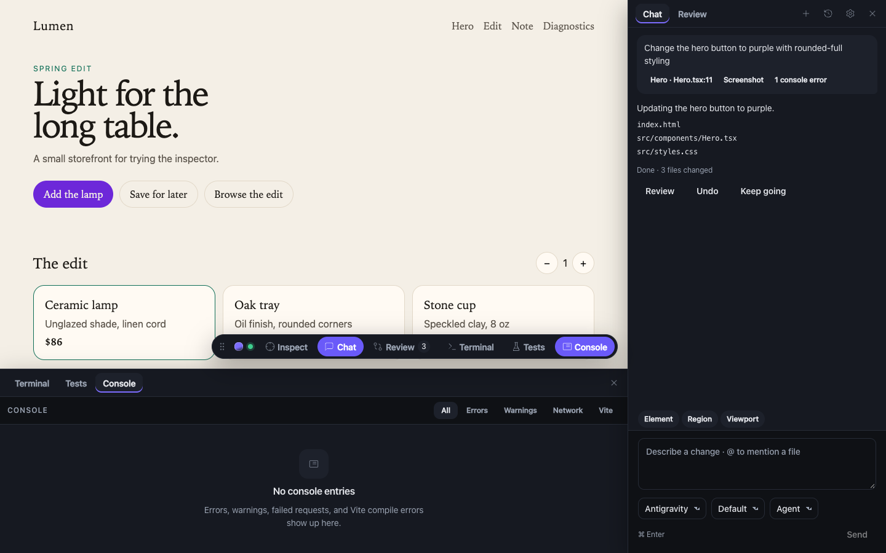
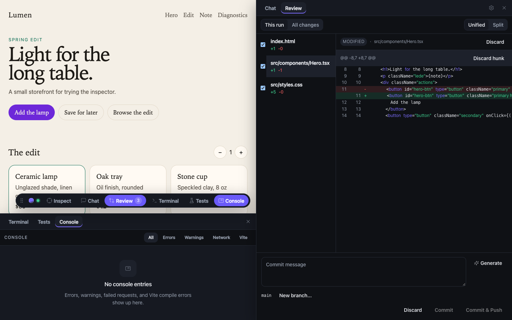

# AI CLI Gateway

An API gateway for AI coding CLIs, plus an in-browser overlay. Inspect an element, describe the change, and a CLI you are already signed into — Cursor (`agent`), Claude Code (`claude`), Codex (`codex`), or Antigravity (`agy`) — edits the project. Vite hot-reloads. You review the diff and commit from the same toolbar.

The same local process is an inference API (`POST /api/v1/infer`, OpenAI-compatible `POST /v1/chat/completions`). Other projects can reuse that sign-in. No LLM API key.



## 60-second install (Vite)

Requires Node.js 20+ and one of those CLIs on `PATH` when you want a real model.

```bash
pnpm add -D @aidev/vite
```

```ts
import { defineConfig } from 'vite';
import react from '@vitejs/plugin-react';
import { aiDevtools } from '@aidev/vite';

export default defineConfig({
  plugins: [react(), aiDevtools()],
});
```

```bash
pnpm dev
```

The plugin injects the overlay in development only, registers the project, and starts the gateway on `127.0.0.1:4100` when `/health` does not answer. Production builds leave it out.

Then: **Inspect** an element → type a change in **Chat** → **Review** the diff → commit. Full walkthrough: [docs/manual.md](docs/manual.md).

## Other frameworks

**Next.js**

```bash
pnpm add -D @aidev/next
```

```ts
import { withAidev } from '@aidev/next';

export default withAidev({
  // existing options
});
```

Add `<AidevScript />` from `@aidev/next/script` to the App Router root layout.

**Script tag** (any localhost / LAN dev server):

```bash
npx aidev start
npx aidev projects add . --origin http://localhost:3000
```

Paste the printed snippet into `<head>`. `--origin` is required.

**Vue:** `aiDevtools({ framework: 'vue' })` is a template `nodeTransform` — pass it to `@vitejs/plugin-vue` and keep `aiDevtools()` in the Vite plugin list.

**Svelte:** `aidevSveltePreprocess()` in `svelte.config.js`, plus `aiDevtools()` in Vite.

`npx aidev init` detects Vite or Next, prints the install command, and edits a simple config when it can. It never installs.

## Use it as a local LLM API

With the gateway running, ask mode is read-only. Nothing in your repo is edited. Cold start is several seconds.

```ts
import { createClient } from '@aidev/client';

const ai = createClient();
const { text } = await ai.generate({ prompt: 'Reply with exactly: pong' });
```

Or the official OpenAI SDK (`usage` is zeros; the CLI does not report tokens):

```ts
import OpenAI from 'openai';

const openai = new OpenAI({
  baseURL: 'http://127.0.0.1:4100/v1',
  apiKey: process.env.AIDEV_TOKEN, // or ~/.aidev/token
});
const completion = await openai.chat.completions.create({
  model: 'cursor',
  messages: [{ role: 'user', content: 'Reply with exactly: pong' }],
});
```

`model` is `"<provider>/<model>"` (for example `cursor/gpt-5`), `"<provider>"`, or omitted. Details are in the [manual](docs/manual.md#inference-api).

## `aidev` CLI

| Command | What it does |
| --- | --- |
| `aidev start [--port N] [--detach]` | Listen on loopback. `--detach` writes a pid file and a log. |
| `aidev stop` | Stop the detached gateway. |
| `aidev status` | Health, projects, active runs, and providers. |
| `aidev init [--dry-run]` | Detect the app and print or apply setup. Never installs. |
| `aidev open [--print]` | Print the dashboard URL. Opens a browser unless `--print`. |
| `aidev doctor [--live]` | Provider capability matrix. `--live` asks each CLI to reply `OK`. |
| `aidev projects add [dir] --origin <url>` | Register a project and print a script-tag snippet. |

The first start creates `~/.aidev/token`. `AIDEV_HOME` overrides that directory.



## Manual

Install variants, overlay walkthrough (inspect, chat, review, terminal, tests, console, settings, ⌘K), gateway auth, inference, CLI flags, and security: **[docs/manual.md](docs/manual.md)**.

This repository also has a Lumen demo: `pnpm install && pnpm build && pnpm demo` → http://127.0.0.1:5173.

## Open decisions

- **Product name and npm scope** are still the `@aidev` placeholder (`aidev` CLI, `~/.aidev`, `<ai-devtools>`). Not decided before publish.
