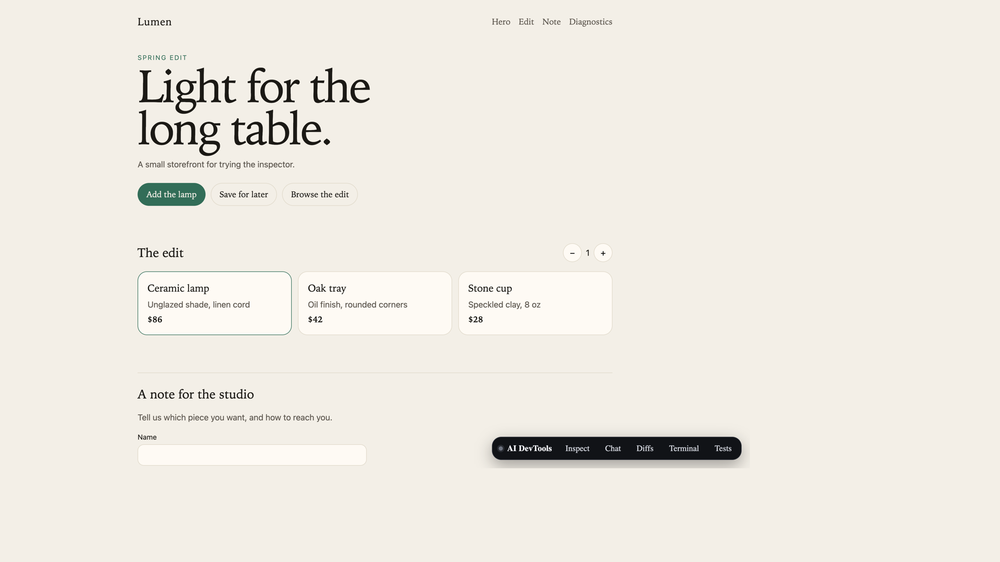

# AI CLI Gateway

Inspect an element in the browser, describe the change, and let a CLI you are already logged into edit the project. The reply streams into a drawer. Vite hot-reloads the page. You review the diff and commit from the same toolbar.

No LLM API key. The gateway shells out to Cursor (`agent`), Antigravity (`agy`), Claude Code (`claude`), or Codex (`codex`).



## Requirements

- Node.js 20 or newer
- pnpm 10 (`packageManager` is `pnpm@10.7.1`)
- Git
- One of `agent`, `agy`, `claude`, or `codex` on `PATH` when you want a real model. `pnpm e2e` uses a scripted provider and does not need a CLI.

## Setup

```bash
pnpm install
pnpm build
pnpm test
```

`pnpm build` compiles the packages and the overlay bundle the Vite plugin injects.

## Run the demo

Two terminals, from the repository root:

```bash
pnpm --filter @gateway/server dev
```

```bash
pnpm demo
```

Open http://127.0.0.1:5173.

1. Click **Inspect**, then click the hero button ("Add the lamp"). The chat chip shows the component and source file.
2. Pick a provider that `GET /health` reports as available.
3. Ask for a change, for example: "Change the hero button to purple with rounded-full styling". Press the send button, or Cmd/Ctrl+Enter.
4. Watch the reply in the chat drawer. The CLI edits the demo, and Vite hot-reloads the page.
5. Open **Diffs**, review the hunks, and click **Commit Changes**. Leave "Push to origin" off unless you mean to push.
6. **Terminal** is a shell in the demo directory. **Tests** runs `pnpm test` for the demo.

The full walkthrough, with the chat, diff, terminal, and test panels, is in the [manual](docs/manual.md).

You can also stream one prompt from the terminal while the gateway is running:

```bash
pnpm --filter @gateway/server client -- "Add a hover transition to the hero button"
```

## Add it to a Vite app

```ts
import { defineConfig } from 'vite';
import react from '@vitejs/plugin-react';
import { aiDevtools } from '@ai-devtools/vite-plugin';

export default defineConfig({
  plugins: [react(), aiDevtools()],
});
```

The plugin injects the overlay only while Vite is serving. Production builds leave it out. Put `aiDevtools()` before the JSX compiler; it moves itself ahead of `@vitejs/plugin-react` when it can. Details and plugin options are in the [manual](docs/manual.md#add-the-overlay-to-a-vite-app).

## Layout

```
ai-cli-gateway/
├── packages/
│   ├── shared-types/       # @gateway/shared-types
│   ├── gateway-core/       # @gateway/core
│   ├── gateway-server/     # @gateway/server
│   ├── devtools-overlay/   # @devtools/overlay
│   └── devtools-vite/      # @ai-devtools/vite-plugin
├── apps/
│   └── demo-react-app/     # Lumen, the storefront used to exercise the overlay
└── examples/
    └── gateway-client/     # Streams one prompt against a running gateway
```

| Package | What it does |
| --- | --- |
| `@gateway/shared-types` | Zod schemas for prompts, stream events, frontend context, and git diffs. |
| `@gateway/core` | CLI adapters, binary lookup, and the process watchdog. |
| `@gateway/server` | HTTP, Server-Sent Events, and WebSocket on `127.0.0.1:4100`. |
| `@devtools/overlay` | Shadow-DOM toolbar: inspect, chat, diffs, terminal, tests. |
| `@ai-devtools/vite-plugin` | Injects the overlay, stamps `data-loc` on JSX, and bridges the dev server. |

## Checks

```bash
pnpm test
pnpm e2e
```

`pnpm e2e` builds the gateway, plugin, and overlay, copies the demo into a temporary git repository, and drives the browser through inspect, prompt, hot reload, diff, and commit. The scripted provider applies the hero-button edit, so the run does not call a real model and does not commit in this repository.

## Safeguards

- The gateway binds to loopback unless `HOST` is set.
- Prompt `cwd` and file paths must stay inside `GATEWAY_ROOT` (the git root of the server process, unless you set the variable). The Vite bridge applies the same check to the project it is serving.
- CLI arguments are an array passed to `spawn`. A hung process is stopped with `SIGTERM`, then `SIGKILL`. The default limit is 5 minutes.
- The git bridge only stages paths inside the Vite project. A dirty or conflicted tree is reported in the chat before the agent edits.
- While a prompt is running, full page reloads are collapsed into one refresh.
- A missing or signed-out CLI returns a structured error with setup steps.

Environment variables, request examples, and the error codes are in the [manual](docs/manual.md).
