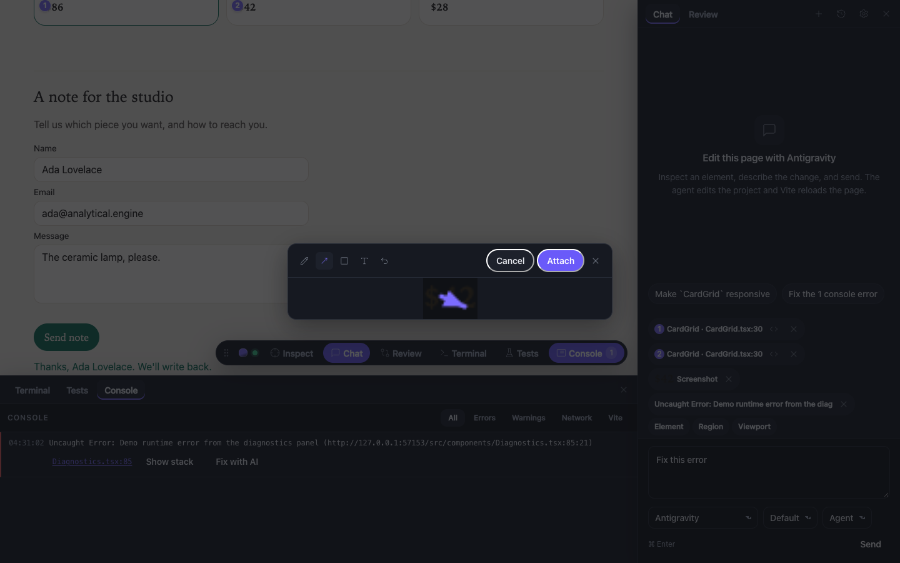
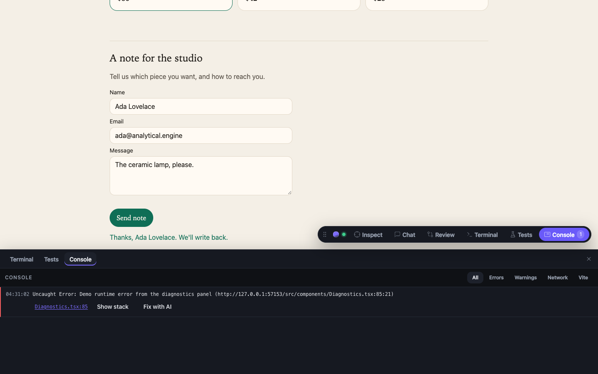

# Manual

Inspect an element in the browser, describe the change, and a CLI you are already signed into edits the project. The overlay streams the reply, Vite hot-reloads, and you review the diff from the same toolbar. The same gateway is a local inference API for other apps.

```
browser overlay  →  gateway :4100  →  agent | agy | claude | codex
                         ↑
                         └── project WebSocket (runs, git, terminal, tests)
```

The Vite / Next plugin does not serve those commands. It injects the overlay, registers the project, and holds a full page reload while a run is in progress.

---

## Install

Requires Node.js 20 or newer. For a real model, one of `agent`, `agy`, `claude`, or `codex` on `PATH`. The overlay is development-only.

`npx aidev init` detects the package manager (lockfile) and Vite / Next / other. It prints the install command and, when it can, edits the config. It never runs the install. `--dry-run` prints the diff and leaves the file unchanged.

### Vite

```bash
pnpm add -D @aidev/vite
```

```ts
import { defineConfig } from 'vite';
import react from '@vitejs/plugin-react';
import { aiDevtools } from '@aidev/vite';

export default defineConfig({
  plugins: [react(), aiDevtools()],
});
```

Then `pnpm dev`. The plugin injects the overlay only while Vite is serving. Production builds leave it out. Put `aiDevtools()` before the JSX compiler; it moves itself ahead of `@vitejs/plugin-react` when it can.

During `serve` the plugin:

1. Injects `globalThis.__AI_DEVTOOLS__` (`gatewayUrl`, `projectId`, `browserToken`, `projectName`) and `<script src="{gatewayUrl}/overlay.js" defer>`. The loader dynamically imports `./overlay/app.js` from the gateway origin.
2. Serves `GET /@ai-devtools/config` (re-registers and returns the project's browser token after a gateway restart). Overlay JS and chunks come from the gateway (`GET /overlay.js` and `GET /overlay/*`).
3. Writes `data-loc="file:line:col"` onto JSX that does not already have one (Babel's 0-based column).
4. Connects to the project WebSocket with the machine token, listens for `project.activity`, and holds Vite `full-reload` messages while `activeRuns > 0`. One reload is sent 250 ms after the count returns to 0. Module hot updates still apply as files change.

`aiDevtools()` accepts:

| Option | Default | Effect |
| --- | --- | --- |
| `gatewayUrl` | `GATEWAY_URL` or `http://127.0.0.1:4100` | Gateway origin injected into the page. |
| `enabled` | `true` while serving, `false` for builds | Turns injection, registration, and the reload hold off. |
| `injectDataLoc` | `true` | Turns the JSX source stamp off. |
| `autoStart` | `true` | When `/health` fails, spawn `aidev start --detach` and poll for 5 seconds. `false` logs `npx aidev start` instead. |
| `framework` | `'react'` | `'vue'` returns a template `nodeTransform` instead of a Vite plugin. |
| `root` | `process.cwd()` | Project root used for Vue `data-loc` paths. |

If the toolbar never appears, the plugin is off for `vite build` and for `aiDevtools({ enabled: false })`. Restart Vite after rebuilding `@aidev/overlay` so the gateway can serve the loader and chunks. The page source should contain `/overlay.js` pointing at the gateway.

### Next.js

```bash
pnpm add -D @aidev/next
```

```ts
import { withAidev } from '@aidev/next';

const nextConfig = {
  // existing options
};

export default withAidev(nextConfig);
```

`withAidev` is a no-op when `NODE_ENV === 'production'`. In development it auto-starts the gateway the same way `@aidev/vite` does, registers the app origin (default `http://localhost:3000`, or `http://localhost:$PORT`; override with `{ origin }`), and exposes `NEXT_PUBLIC_AIDEV_GATEWAY_URL`, `NEXT_PUBLIC_AIDEV_PROJECT_ID`, `NEXT_PUBLIC_AIDEV_BROWSER_TOKEN`, and `NEXT_PUBLIC_AIDEV_PROJECT_NAME`. Next.js 12.1+ awaits a Promise default export, so `export default withAidev(nextConfig)` is valid.

Add `<AidevScript />` to the App Router root layout. It is a Server Component (no hooks) and renders nothing in production. In development it writes `window.__AI_DEVTOOLS__` (with `<` escaped in the JSON) and loads `GET /overlay.js` from the gateway:

```tsx
import { AidevScript } from '@aidev/next/script';

export default function RootLayout({ children }: { children: React.ReactNode }) {
  return (
    <html lang="en">
      <body>
        {children}
        <AidevScript />
      </body>
    </html>
  );
}
```

If `next.config` is a function, `export default nextConfig`, or already wrapped, `aidev init` prints these instructions instead of editing. create-next-app's `const nextConfig = { … }; export default nextConfig` is not a simple object export, so wrap it yourself as shown above.

`data-loc` uses the Babel JSX transform from `@aidev/vite` as a webpack loader (`@aidev/next/loader`) on user `.jsx` / `.tsx` (not `node_modules`). This workspace's types and tests depend on Next 16.4.

| Bundler | What `withAidev` does | What works |
| --- | --- | --- |
| **Webpack** (`next dev --webpack`, Next 14, Next 15 without Turbopack) | `webpack(config, { dev, isServer })` adds an `enforce: 'pre'` loader in development | Reliable. The loader rewrites TSX in place, then SWC compiles it. |
| **Turbopack** (default in Next 16; `next dev --turbopack` in 15) | Sets `turbopack.rules` for `*.jsx` / `*.tsx` (Next ≥ 15.3). Also sets `experimental.turbo.rules` on Next 13–15. Next 16 removed `experimental.turbo`. | Next documents webpack loaders under Turbopack for loaders that return **JavaScript**. This loader is a TSX→TSX stamp. If a given Next version does not apply it, use `next dev --webpack`. |

Do not add a `babel.config` just to get `data-loc` — that disables SWC for webpack. There is no SWC plugin.

### Script tag

`--origin` is required. It must be `http` or `https` on localhost, `127.0.0.1`, or a private LAN address. That origin is added to the project's CORS allowlist. The command registers the directory (defaults to `.`) and prints a snippet that includes a project-scoped browser token:

```bash
npx aidev start
npx aidev projects add . --origin http://localhost:3000
```

```html
<script>
  window.__AI_DEVTOOLS__ = { gatewayUrl, projectId, browserToken, projectName };
</script>
<script src="http://127.0.0.1:4100/overlay.js" defer></script>
```

Paste the printed snippet into `<head>`. Prefer `@aidev/next` for App Router apps. Use the origin your dev server actually listens on. The token is for local development only — do not commit it or ship it in production. Tokens are stored in `$AIDEV_HOME/browser-tokens.json` (mode `0600`) so the same snippet still works after `aidev` restarts.

`GET /overlay.js` is the public loader (static code, no auth). It imports ESM chunks from `GET /overlay/*` (JS, CSS, and source maps) on the same origin. Path traversal outside the overlay dist is rejected. If the loader 404s, build `@aidev/overlay` and restart the gateway.

Component names come from React Fiber when it is present; otherwise the inspector shows the DOM path and `data-loc` is absent unless you add Vue or Svelte stamping.

### Vue

`@vitejs/plugin-vue` compiles templates itself, so this plugin cannot inject a transform from the Vite plugin list. `aiDevtools({ framework: 'vue' })` returns a `compilerOptions.nodeTransforms` function. Pass it into plugin-vue and keep `aiDevtools()` for overlay injection. `@vue/compiler-sfc` is an optional peer; install it with Vue.

```ts
import { defineConfig } from 'vite';
import vue from '@vitejs/plugin-vue';
import { aiDevtools } from '@aidev/vite';

export default defineConfig({
  plugins: [
    vue({
      template: {
        compilerOptions: {
          nodeTransforms: [aiDevtools({ framework: 'vue' })],
        },
      },
    }),
    aiDevtools(),
  ],
});
```

Native elements get `data-loc="relative/path.vue:line:col"` (Vue's 1-based `loc.start`). Components are not stamped.

### Svelte

Use `aidevSveltePreprocess()` in `svelte.config.js` (or the `preprocess` option of `@sveltejs/vite-plugin-svelte`). `svelte` is an optional peer. Keep `aiDevtools()` in `vite.config` for overlay injection.

```js
import { vitePreprocess } from '@sveltejs/vite-plugin-svelte';
import { aidevSveltePreprocess } from '@aidev/vite';

export default {
  preprocess: [aidevSveltePreprocess(), vitePreprocess()],
};
```

```ts
import { defineConfig } from 'vite';
import { svelte } from '@sveltejs/vite-plugin-svelte';
import { aiDevtools } from '@aidev/vite';

export default defineConfig({
  plugins: [svelte(), aiDevtools()],
});
```

Native elements get `data-loc="relative/path.svelte:line:col"` from `svelte/compiler` parse offsets (1-based line and column). Components are not stamped.

---

## Overlay walkthrough

The toolbar is a custom element, `<ai-devtools>`, in an open shadow root so the page's CSS does not restyle it. A **launcher pill** sits in a corner (drag it; the position is persisted). The status dot is green when the project WebSocket is open, amber while a run is active, grey when offline.

The **side dock** holds Chat and Review. The **bottom dock** holds Terminal, Tests, and Console. Both can be open at once. Below 768 px they become sheets. Settings → Dock behavior chooses **Push the page** (default) or **Overlay the page**.

If the status dot stays idle, the project WebSocket did not open. The plugin auto-starts the gateway unless `autoStart` is false. If it is still down, run `npx aidev start`, or set `GATEWAY_URL` to the gateway you already started.

### Inspect

Click **Inspect** on the pill (or ⌘⇧C / Ctrl+Shift+C), then click an element. The click is captured before the page's own handlers. Escape leaves inspect mode without selecting.

The hover label shows the component and source file when React Fiber or `data-loc` can resolve them. ↑ / ↓ while hovering walks ancestors and descendants that have a user-code `data-loc`. Hold Alt to tint margin and padding. Alt-click opens the file in your editor through the gateway (`cursor -g`, `code -g`, or `$VISUAL` / `$EDITOR` — see `editor` in `config.json`). Shift-click adds up to five elements.

The chat chip names the component and source. A breadcrumb on the chip retargets to an ancestor.

### Chat


The prompt sent to the CLI includes:

- the selected element: tag, id, class, a slice of outer HTML, and a few computed styles
- the source location and React props when Fiber exposes them
- recent console errors, warnings, and unhandled exceptions (when auto-attach is on)
- recent failed network requests
- a screenshot of the element, when the browser allows it

Suggestions fill the box. Send with the button or ⌘/Ctrl+Enter. **Stop** (or ⌘/Ctrl+.) cancels the running session. Send stays disabled, with a tooltip, when the selected provider is known to be missing.

Pick **Agent** (edits) or **Ask** (read-only) under the composer, plus provider and model. Follow-ups stay on the same thread: Cursor and Claude resume with `providerSessionId`; other providers get the last six turns, capped at 8 KB.

A conflicted git tree stops the run. A dirty tree is shown as a notice. After the agent edits files, the run footer offers **Review**, **Undo**, and **Keep going**.

Each agent-mode run snapshots the project tree first (tracked and untracked files, without touching the working copy) and records the paths it changed. **Undo** restores only those paths to the snapshot: the agent's new files disappear, and a file you had already edited is put back to *your* version, not `HEAD`. Ask and plan runs do not take a snapshot. Repos with no commits skip the snapshot and cannot be undone this way. If a later run in the same project touched the same files, undo is refused unless you force it (`POST /api/v1/runs/:runId/restore` with `"force": true`).

The gateway runs at most one agent-mode run per project (further starts are `queued` and run FIFO). Across all projects, `maxConcurrentRuns` in `config.json` (default 4) caps live runs.

**History** in the chat header lists this project's threads and resumes any of them. **New chat** starts a fresh thread.

#### Screenshots and annotate

Composer actions capture **Element**, **Region** (drag a rectangle), or **Viewport**. Capture opens an annotation layer: pen, arrow, rectangle, and text, plus undo, then **Attach**. Images are downscaled (long edge 1600 px) and sent as attachments. A tainted canvas shows a warning chip instead of failing silently.



### Review

**Review** lists files in the working tree. Scope is **This run** (the files that run touched) or **All changes**. Toggle unified / split. Select files with the checkboxes, then type a commit message.


- **Generate** drafts a commit message from the selected diff (an ask-mode inference run).
- **New branch…** creates a branch (suggested `aidev/<slug>` from the thread title) before committing.
- **Commit** and **Commit & Push**. After a push, **Open PR** appears when `gh` is available and the branch is not `main` / `master`.
- **Discard** asks for confirmation, then restores tracked files and removes untracked files that were listed and checked. Paths that leave the project directory are rejected.
- Per-file **Discard** and per-hunk **Discard hunk** apply through the gateway.

The badge on the pill is the number of files in the summary.

Commit fails with "not a git repository" when the app root is not inside a work tree. Initialize git there, or run the app from a subdirectory of a repository.

### Terminal

**Terminal** starts `$SHELL` (or `bash`) in the project directory and connects it to an xterm.js pane. The gateway uses `node-pty` when its native binding loads. If it does not, it falls back to a piped interactive shell.

Switching docks leaves the shell running. The close button disposes that session. The shell is the same user as the Vite process, so it can run git, pnpm, and the project scripts.

### Tests

**Tests** runs the project's `test` script. It walks up from the project root and prefers pnpm (`pnpm-lock.yaml` or `pnpm-workspace.yaml`), then npm, then yarn. With no script, a project that depends on Vitest runs `npx vitest run`. Output streams into the panel. Failures expand with expected / received when the JSON reporter is available. **Stop** aborts the run. **Re-run failed** and **Fix with AI** attach a failure to a new chat.

The kicker is the `name` from the project's `package.json`, or **Tests** when that name is missing. Starting another run aborts the one in progress. Settings (and a checkbox on the panel) can run tests after each agent run that edited files.

### Console



The bottom **Console** lists errors, warnings, failed `fetch` / `XMLHttpRequest` calls, and Vite compile errors. Filters: All, Errors, Warnings, Network, Vite. Each row can open the source in the editor and **Fix with AI**, which opens Chat with that error attached.

The pill shows an error badge. If Vite's own error overlay is present, it gets a **Fix with AI** button as well.

### Settings

Open from the command palette. Three sections:

- **General** — theme (dark / light / system) and dock behavior (push / overlay).
- **Agent** — default provider; auto-attach for console errors, failed requests, and screenshots; run tests after each agent run.
- **Connection** — gateway URL (read-only), status, version, and a link to the dashboard.

### Command palette (⌘K)

⌘K / Ctrl+K toggles the palette (also while the page has focus). Commands:

- Inspect element
- New chat
- Open Review
- Run tests
- Open terminal
- Open console
- Toggle theme
- Settings
- Hide toolbar until reload
- Switch to an available provider

Other shortcuts: ⌘⇧C / Ctrl+Shift+C toggles inspect. ⌘/Ctrl+Enter sends. ⌘/Ctrl+. stops a run. Escape closes the topmost layer (palette → settings → annotate → inspect stays on Escape in the picker itself → docks).

---

## Gateway

The server listens on `127.0.0.1:4100` unless `HOST` and `PORT` say otherwise. `aidev start --port` writes the chosen port into `config.json`.

### Auth and tokens

| Token | Where | What it can do |
| --- | --- | --- |
| **Machine token** | `~/.aidev/token` (mode `0600`, created on first start) | Every `/api/v1/*` route, `/v1/*`, WebSocket, dashboard, shutdown. |
| **Browser token** | `$AIDEV_HOME/browser-tokens.json` | That project's overlay: runs, git, terminal, tests, open-in-editor. Rejected on inference. |
| **Inference token** | `config.json` `inferenceTokens` | `POST /api/v1/infer` and `/v1/*` only. |

Send `Authorization: Bearer <token>`. WebSockets may use `?token=` instead. `GET /health` is open and returns `{ status, version }`. Authenticated `/health` also includes `availableProviders`. No token is `401`. A browser token on another project, a non-allowlisted WebSocket `Origin`, a browser token on `/api/v1/infer`, or an inference token on a non-inference route is `403`.

`POST /api/v1/shutdown` accepts only the machine token.

`GET /api/v1/status` (machine token) returns `activeRuns`, `projects`, and `providers`. `GET /api/v1/providers` is the same provider list. `GET /api/v1/doctor` is the matrix `aidev doctor` prints.

### Home directory

`AIDEV_HOME` overrides `~/.aidev` (mode `0700`):

```
token                     machine token (0600)
config.json               port, projects, inferenceTokens, retentionDays, defaultProvider, defaultModel, maxConcurrentRuns, editor
browser-tokens.json       project-scoped overlay tokens (0600)
threads/<id>.json         thread + run metadata
threads/<id>.jsonl        append-only event log
scratch/<runId>/          empty cwd for inference; deleted after the run unless keep
attachments/<runId>/      screenshots and other images
logs/gateway.log          detached-start log
gateway.pid               detached-start pid
```

`config.json` `editor` (default `auto`) chooses the binary for Open in editor. `auto` runs `cursor -g file:line:col` when `cursor` is on `PATH`, else `code -g …`, else `$VISUAL` or `$EDITOR` with the file path only.

Threads with `keep: false` older than `retentionDays` (default 7) are removed on startup and every hour. Overlay threads start with `keep: true`.

Register a repo with `aidev projects add <path> --origin <url>`, or set `GATEWAY_ROOT` to auto-register one root at startup. The Vite / Next plugin registers the project it is serving. A prompt `cwd` must resolve inside a registered project. A symlink whose target leaves that project is rejected (`path_escape`).

### CORS

`Access-Control-Allow-Origin` is set only for origins registered by a project (and the gateway's own origin after it binds). Any other `Origin` gets no CORS header. Requests with no `Origin` (curl, Node) are allowed when the token is valid. A WebSocket upgrade with a non-allowlisted `Origin` is rejected.

### Dashboard

`aidev open` prints and opens `http://127.0.0.1:<port>/dashboard/#token=<machine token>`. The SPA reads the token from the hash, stores it in `sessionStorage`, and removes it from the address bar. It never puts the token in a query string. `--print` prints the URL and does not open a browser.

The gateway serves the built Preact app from `@aidev/dashboard` at `GET /dashboard/*` with no auth on the static files. API calls still use `Authorization: Bearer <token>`. `GET /` redirects to `/dashboard/`. If the dashboard has not been built, those routes return 404 with `pnpm --filter @aidev/dashboard build`.

Pages: **Providers** (capability matrix and doctor), **Projects**, **Threads** (Keep / Delete), **Playground** (streaming `POST /api/v1/infer` and a copyable `curl` that uses `$AIDEV_TOKEN`). Same-origin, so CORS is not involved.

### Environment

| Variable | Default | Purpose |
| --- | --- | --- |
| `AIDEV_HOME` | `~/.aidev` | Token, config, pid file, logs, threads. Tests must point this at a temp directory. |
| `AIDEV_TOKEN` | token file in `AIDEV_HOME` | Machine token override for scripts and `@aidev/client`. |
| `AIDEV_URL` | `http://127.0.0.1:4100` | Gateway origin for `createClient()`. |
| `HOST` | `127.0.0.1` | Bind address. Loopback keeps the gateway off the network. |
| `PORT` | `4100`, or `config.json` `port` | TCP port. |
| `GATEWAY_ROOT` | unset | Auto-register that directory as a project root at startup. |
| `GATEWAY_URL` | `http://127.0.0.1:4100` | Gateway origin the plugin injects into the page. |
| `GATEWAY_LOG_LEVEL` | `info` | `debug`, `info`, `warn`, `error`, or `silent`. |
| `SHELL` | process shell, or `bash` | In-browser terminal. |

There is no API-key variable. Each CLI keeps its own login.

---

## Inference API

`POST /api/v1/infer` runs a signed-in CLI in **ask** mode (read-only) inside a fresh `$AIDEV_HOME/scratch/<runId>` directory. That directory is empty and is not a git repo. It is deleted after the run unless `"keep": true`. Nothing in your project is edited.

```bash
curl -s http://127.0.0.1:4100/api/v1/infer \
  -H "authorization: Bearer $(cat ~/.aidev/token)" \
  -H 'content-type: application/json' \
  -d '{
    "messages": [
      { "role": "user", "content": "Reply with exactly: pong" }
    ]
  }'
```

A successful body is `{ id, provider, model, text, durationMs, threadId }`. The run is stored as a thread with `source: "api"` and `keep: false` unless you pass `"keep": true`.

`provider` defaults to `config.json` `defaultProvider`, then the first available verified CLI, preferring Cursor. `model` defaults to `defaultModel` when set.

### `@aidev/client`

```ts
import { createClient } from '@aidev/client';

const ai = createClient(); // AIDEV_URL, AIDEV_TOKEN, or ~/.aidev/token
await ai.generate({ prompt: 'Reply with exactly: pong', model: 'claude/sonnet' });
for await (const chunk of ai.stream({ prompt: 'Say hello' })) process.stdout.write(chunk);
const product = await ai.generateObject({
  prompt: 'Invent a product',
  schema: {
    type: 'object',
    properties: { name: { type: 'string' }, tags: { type: 'array', items: { type: 'string' } } },
    required: ['name', 'tags'],
  },
});
```

`generateObject` accepts a JSON Schema object or a Zod schema. Zod is converted with `zod-to-json-schema` when that package is installed. Failures throw `AidevClientError` with a `code`. See `examples/inference-node`.

### OpenAI-compatible endpoint

`POST /v1/chat/completions` is a façade over the same infer pipeline. Use the official `openai` package with `baseURL: 'http://127.0.0.1:4100/v1'` and `apiKey` set to the machine token or an inference token. Threads are stored with `source: "openai"`.

```ts
import OpenAI from 'openai';

const openai = new OpenAI({
  baseURL: 'http://127.0.0.1:4100/v1',
  apiKey: process.env.AIDEV_TOKEN,
});

const completion = await openai.chat.completions.create({
  model: 'cursor/gpt-5',
  messages: [{ role: 'user', content: 'Reply with exactly: pong' }],
});
```

`model` is `"<provider>/<model>"` (for example `cursor/gpt-5`, `claude/sonnet`), just `"<provider>"`, or omitted / `"default"`. `GET /v1/models` lists those ids plus the plain provider ids.

`"stream": true` sends SSE `chat.completion.chunk` frames (`choices[0].delta.content`, first chunk includes `role: "assistant"`, last chunk has `finish_reason: "stop"`), then `data: [DONE]`. `usage` is zeros — the CLI does not report token counts.

`response_format: { type: 'json_schema', json_schema: { schema } }` and `{ type: 'json_object' }` use the structured pipeline. `tools` or `functions` return `400`. See `examples/inference-openai`.

### Auth

`/api/v1/infer` and `/v1/*` accept the machine token or a token listed in `config.json` `inferenceTokens`. Put a dedicated token in another project's `.env`. A browser token is `403`. No token is `401`.

### Structured output

Pass `jsonSchema` (a JSON Schema object). The gateway appends `Reply with only a JSON value matching this JSON Schema: …` to the system instructions. Claude also receives `--json-schema` when that CLI advertises it. The first JSON object or array in the reply is extracted, then validated with Ajv. One retry is sent with the validation errors. A second failure is `422` `{ error: "invalid_structured_output", raw, issues }`. On success the body includes `object` next to `text`.

### Images

`images` on `/api/v1/infer` is `[{ dataUrl } | { path }]`. OpenAI messages may use `{ type: 'image_url', image_url: { url: 'data:image/png;base64,…' } }` (data URLs only). Allowed mime types are png, jpeg, webp, and gif; at most 5 images, 8 MB each.

The gateway writes files into the scratch workspace at `scratch/<runId>/attachments/n.<ext>` and appends their absolute paths to the prompt. When `"keep": true`, it also copies them to `$AIDEV_HOME/attachments/<runId>/`.

### Streaming

`"stream": true` on `/api/v1/infer` returns Server-Sent Events. Only assistant text is sent (`event: delta` with `{ "text" }`). The stream ends with `event: done` `{ id, text, durationMs }` or `event: error`.

### Limitations

Each call starts a CLI process. Cold start is typically **several seconds**. Timeouts follow the gateway watchdog (5 minutes, or `timeoutMs`). Concurrent runs share `maxConcurrentRuns` (default 4); over the limit the reply is `429` with `Retry-After: 5`.

---

## CLI reference

The `@aidev/gateway` package ships a `bin` named `aidev`.

| Command | What it does |
| --- | --- |
| `aidev start [--port N] [--detach]` | Listen on loopback. `--detach` respawns itself, writes `$AIDEV_HOME/gateway.pid` with the child pid (before waiting for `/health`), and appends `$AIDEV_HOME/logs/gateway.log`. |
| `aidev stop` | Signals the pid file and removes it. If the pid file is missing but `/health` on the configured port reports this gateway's version, calls `POST /api/v1/shutdown` with the machine token. |
| `aidev status` | Calls `/health` and `/api/v1/status` with the machine token and prints projects, active runs, and providers. Does not need the pid file. |
| `aidev doctor [--live]` | Prints each provider's availability, binary path, and `<bin> --version`. `--live` asks each available CLI to reply `OK` in a temp directory. The same matrix is `GET /api/v1/doctor`. |
| `aidev init [--dry-run]` | Detects the package manager and Vite / Next / plain. For Vite, prints `<pm> add -D @aidev/vite` and edits `vite.config.*` when it can. For Next, prints `<pm> add -D @aidev/next`, layout instructions for `<AidevScript />`, and wraps a simple `next.config.*` object export. Never installs. |
| `aidev projects add [dir] --origin <url>` | Registers the root (`.` when `dir` is omitted) and prints a script-tag snippet with a browser token. `--origin` is required and must be http(s) localhost / loopback / LAN. Persists the token in `$AIDEV_HOME/browser-tokens.json` (mode `0600`). |
| `aidev open [--print]` | Prints `http://127.0.0.1:<port>/dashboard/#token=<machine token>` and opens it with `open` / `xdg-open`. `--print` skips the browser. |

`aidev stop` saying the gateway is not running usually means `$AIDEV_HOME/gateway.pid` is missing and `/health` is not this version. `aidev status` uses `/health` and does not need the pid file.

`pnpm --filter @aidev/gateway dev` does not authorize the git toplevel by itself. Register each repo you want the CLIs to edit (`aidev projects add`, the Vite plugin, or `GATEWAY_ROOT`).

Providers the gateway can spawn:

| Provider | Command | Lookup |
| --- | --- | --- |
| `cursor` | `agent` | `agent`, `cursor-agent`, then `~/.local/bin` and `~/.cursor/bin` |
| `antigravity` | `agy` | `agy`, then `~/.local/bin` and `~/.antigravity/bin` |
| `claude` | `claude` | `claude`, then `~/.local/bin` and `~/.claude/local` |
| `codex` | `codex` | `codex`, then `~/.local/bin` and `~/.npm-global/bin` |

`provider_unavailable` means the binary is not on `PATH` and not in those lookup paths. The response `setup` array is what to install and which command to run once so the CLI can sign in. `cli_auth_required` means the process started and then asked for login. Sign in with `agent login` in a normal terminal. The gateway does not store credentials.

The Cursor CLI persists `CURSOR_AUTH_TOKEN` as both its access token and its refresh token, which signs out `agent login`. The gateway clears that variable on the child. `CURSOR_API_KEY` is still passed through.

---

## Security

### Machine token

The first start writes `~/.aidev/token` (mode `0600`, 32 random bytes, base64url). Any process run by the same user can read it: the Vite plugin, `@aidev/client`, and `aidev`. Treat it like a local password. The default bind is loopback so it is not reachable from the network unless you set `HOST`.

### Browser tokens

`POST /api/v1/projects/register` (machine token) takes `{ root, origin }` and returns `{ projectId, browserToken }`. The token is scoped to that project and stored in `$AIDEV_HOME/browser-tokens.json` (mode `0600`) so a script-tag snippet survives a gateway restart. Re-registering the same root keeps the project id and the same token, and may add an origin.

The token is injected into the page in development. Do not commit it or ship it in a production bundle. A browser token cannot start inference, cannot shut the gateway down, and cannot touch another project's root.

### Redaction

Before context leaves the page:

- `value` attributes of inputs of type password, email, tel, or with `autocomplete` containing `cc-` are stripped
- query keys matching `token`, `key`, `secret`, `password`, `auth`, or `session` are replaced with `REDACTED`
- total context JSON is capped at 32 KB, trimming oldest logs first

The in-browser terminal drops child environment variables whose names match `TOKEN`, `SECRET`, `KEY`, or `PASSWORD`, and keeps `PATH`-like names. `allowRemoteShell` defaults to false; on loopback the token check is what gates the shell.

### Attachments

Overlay screenshots and inference images are written under `$AIDEV_HOME/attachments/<runId>/` (and, for inference, also into the scratch workspace so the CLI can `Read` them). Allowed types are png, jpeg, webp, and gif; at most 5 images, 8 MB each. The CLI sees file paths, not raw bytes in argv.

### Other safeguards

- Prompt `cwd` and file paths are realpath-checked inside a registered project, including symlinks.
- Adapter `spawn` uses `shell: false`. Arguments are a discrete argv array.
- Git paths are confined to the project. An untracked symlink is shown as a symlink; its target is not read. Discard deletes only listed untracked paths.
- A hung process is stopped with `SIGTERM`, then `SIGKILL`. The default limit is 5 minutes (`timeoutMs` overrides it).
- The overlay talks only to the gateway. Chat, review, the terminal, tests, and console share the project WebSocket.
