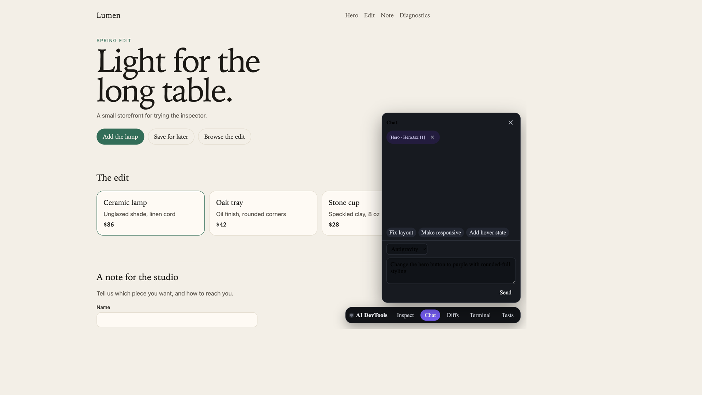
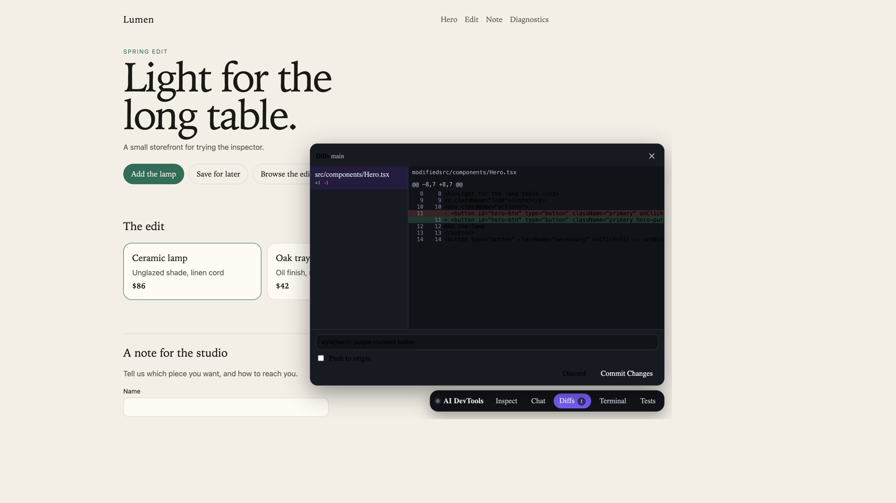
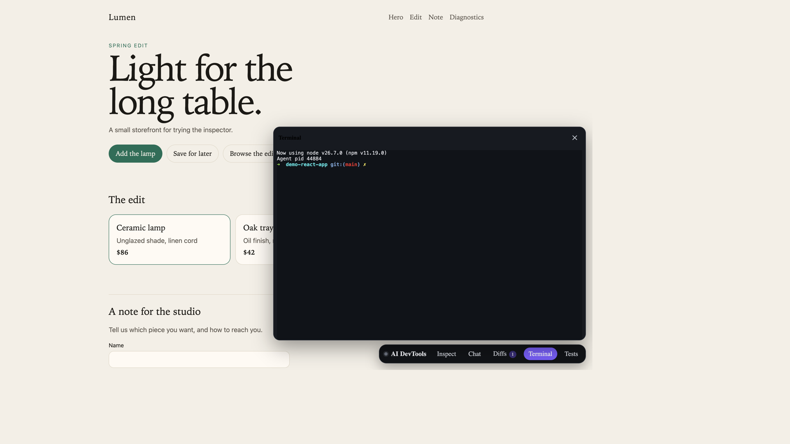
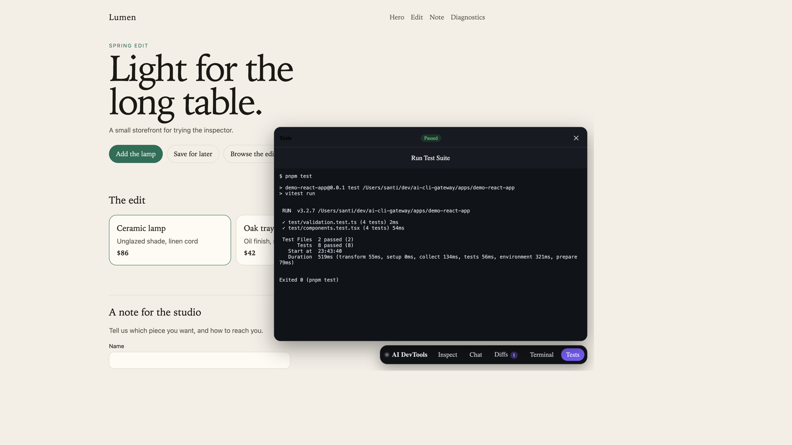

# Manual

This is the operator's guide for the gateway and the in-browser overlay: how to run the Lumen demo, how to drop the toolbar into another Vite app, and how to call the HTTP API yourself.

## The loop

The overlay collects context in the page and sends every command to the gateway over one project WebSocket: chat, diffs, the terminal, and tests. The gateway runs one already-authenticated CLI in the project directory and normalizes its output into a single event stream. The CLI writes files on disk. Vite hot-reloads them. You commit from the drawer.

```
browser overlay  →  gateway :4100  →  agent | agy | claude | codex
                         ↑
                         └── project WebSocket (runs, git, terminal, tests)
```

The Vite plugin does not serve those commands. It injects the overlay, registers the project, and holds a full page reload while `project.activity` reports a run in progress.

## Run the Lumen demo

From the repository root:

```bash
pnpm install
pnpm build
pnpm demo
```

Open http://127.0.0.1:5173. The toolbar is injected in development only. If nothing is listening on `127.0.0.1:4100`, the plugin runs `aidev start --detach` and waits up to 5 seconds. Set `autoStart: false` to skip that and print `npx aidev start` instead. `AIDEV_HOME` chooses the directory for the machine token; the default is `~/.aidev`.


Lumen is a small storefront: a header, a hero, a quantity counter, product cards, a note form with validation, and a diagnostics panel that can log a warning, log an error, or throw. Those pieces give the inspector something real to select.

Confirm the gateway is up, then ask it which CLIs it can see. `/health` is open and only reports status and version. Provider details require the machine token from `~/.aidev/token`:

```bash
curl -s http://127.0.0.1:4100/health
```

```json
{ "status": "ok", "version": "0.0.1" }
```

```bash
curl -s http://127.0.0.1:4100/api/v1/status \
  -H "authorization: Bearer $(cat ~/.aidev/token)"
```

The status body includes `activeRuns`, `projects`, and `providers`. `GET /api/v1/providers` returns the same provider list under `providers`. Choose a provider whose `available` is `true`. `/health` also includes `availableProviders` when the same bearer token is sent, which is what the overlay polls.

## Use the overlay

The toolbar is a custom element, `<ai-devtools>`, rendered in an open shadow root so the page's CSS does not restyle it. The dot next to the name is green when the project WebSocket is open.

### Inspect and chat

Click **Inspect**, then click an element. The click is captured before the page's own handlers, so selecting the hero button does not add the lamp to the cart. Press Escape to leave inspect mode without selecting.

The chip names the React component and the source location. React Fiber `_debugSource` is preferred. Anything else uses the `data-loc="file:line:col"` attribute the Vite plugin stamps onto JSX. **Open in editor** on the chip goes through the gateway (not a `vscode://` link); see below.



The prompt sent to the CLI includes:

- the selected element: tag, id, class, a slice of outer HTML, and a few computed styles
- the source location and React props when Fiber exposes them
- the last console errors, warnings, and unhandled exceptions
- recent failed network requests
- a screenshot of the element, when the browser allows it

Suggestions ("Fix layout", "Make responsive", "Add hover state") only fill the box. Send with the button or with Cmd/Ctrl+Enter. **Stop** cancels the running session. Send stays disabled, with a tooltip, when the selected provider is known to be missing. Those options are disabled in the provider menu.

A conflicted git tree stops the run. A dirty tree is shown as a notice in the chat. After the agent edits files, a notice offers **Review diffs**.

### Undo a run

Each agent-mode run snapshots the project tree first (tracked and untracked files, without touching the working copy) and records the paths it changed. **Undo** on that run restores only those paths to the snapshot: the agent's new files disappear, and a file you had already edited is put back to *your* version, not `HEAD`. Other files, including untracked files the agent never touched, stay put.

Undo is `git.checkpoint.restore { runId }` on the project WebSocket, or `POST /api/v1/runs/:runId/restore`. If a later run in the same project touched the same files, the reply is `conflict_newer_run` unless you pass `"force": true`. Ask and plan runs do not take a snapshot. Repos with no commits skip the snapshot and cannot be undone this way.

The gateway runs at most one agent-mode run per project (further `run.start` requests are accepted as `queued` and start FIFO). Across all projects, `maxConcurrentRuns` in `config.json` (default 4) caps live runs; extra HTTP `/prompt` and `/sessions` requests return 429 with `Retry-After: 5`, while workspace runs queue.

### Diffs

**Diffs** lists staged, unstaged, and untracked files inside the Vite project. Each file shows additions and deletions. The hunk view is the unified diff.



Type a commit message and click **Commit Changes**. "Push to origin" pushes the current branch after the commit succeeds. **Discard** asks for confirmation, then restores tracked files and removes untracked files that the summary listed. Paths that leave the project directory are rejected.

The badge on the toolbar is the number of files in the summary.

### Terminal

**Terminal** starts `$SHELL` (or `bash`) in the project directory and connects it to an xterm.js pane. The gateway uses `node-pty` when its native binding loads. If it does not, it falls back to a piped interactive shell.



Switching to Chat, Diffs, or Tests leaves the shell running. The close button on the terminal panel disposes that session. The shell is the same user as the Vite process, so it can run git, pnpm, and the project scripts.

### Tests

**Tests** runs the project's `test` script. It walks up from the Vite root and prefers pnpm (`pnpm-lock.yaml` or `pnpm-workspace.yaml`), then npm, then yarn. With no script, a project that depends on Vitest runs `npx vitest run`. Output streams into the panel. The badge reads Passed or Failed from the exit code. **Stop** aborts the run in progress. The kicker above the title is the `name` from the Vite project's `package.json`, or **Tests** when that name is missing.



Starting another run aborts the one in progress.

## Add the overlay to a Vite app

From the app directory, `aidev init` detects the package manager (lockfile) and the framework. For Vite it prints the install command and, when `vite.config.(ts|js|mjs)` has a `plugins: [` array, inserts the plugin. For Next.js it prints `add -D @aidev/next` and, when `next.config.(js|mjs|ts)` is a plain `export default {…}` or `module.exports = {…}`, wraps that object with `withAidev`. It never runs the install. `--dry-run` prints the diff and leaves the file unchanged.

```bash
cd my-app
npx aidev init
pnpm add -D @aidev/vite   # or npm/yarn/bun, as printed
```

The edit it applies is:

```ts
import { defineConfig } from 'vite';
import react from '@vitejs/plugin-react';
import { aiDevtools } from '@aidev/vite';

export default defineConfig({
  plugins: [react(), aiDevtools()],
});
```

If the Vite config has no `plugins: [` array, `aidev init` prints the wrap instead of editing.

### Next.js (`@aidev/next`)

```bash
cd my-app
npx aidev init
pnpm add -D @aidev/next   # or npm/yarn/bun, as printed
```

Wrap the config (this is also the edit `aidev init` applies to a plain object export):

```ts
import { withAidev } from '@aidev/next';

const nextConfig = {
  // existing options
};

export default withAidev(nextConfig);
```

`withAidev` is a no-op when `NODE_ENV === 'production'`. In development it auto-starts the gateway the same way `@aidev/vite` does, registers the app origin (default `http://localhost:3000`, override with `{ origin }`), and exposes `NEXT_PUBLIC_AIDEV_GATEWAY_URL`, `NEXT_PUBLIC_AIDEV_PROJECT_ID`, `NEXT_PUBLIC_AIDEV_BROWSER_TOKEN`, and `NEXT_PUBLIC_AIDEV_PROJECT_NAME`. Next.js 12.1+ awaits a Promise default export, so `export default withAidev(nextConfig)` is valid.

Add `<AidevScript />` to the App Router root layout. It is a Server Component (no hooks) and renders nothing in production. In development it writes `window.__AI_DEVTOOLS__` (with `<` escaped in the JSON) and loads `GET /overlay.js` from the gateway:

```tsx
import { AidevScript } from '@aidev/next/script';

export default function RootLayout({ children }: { children: React.ReactNode }) {
  return (
    <html lang="en">
      <body>
        {children}
        <AidevScript />
      </body>
    </html>
  );
}
```

If `next.config` is a function, `export default nextConfig`, or already wrapped, `aidev init` prints these instructions instead of editing.

#### data-loc: webpack vs Turbopack

This workspace's `@aidev/next` types and tests depend on **Next 16.4**. The stamper is the existing Babel JSX transform from `@aidev/vite`, run as a webpack loader (`@aidev/next/loader`) on user `.jsx`/`.tsx` (not `node_modules`).

| Bundler | What `withAidev` does | What works |
| --- | --- | --- |
| **Webpack** (`next dev --webpack`, Next 14, Next 15 without Turbopack) | `webpack(config, { dev, isServer })` adds an `enforce: 'pre'` loader in development | Reliable. The loader rewrites TSX in place, then SWC compiles it. |
| **Turbopack** (default in Next 16; `next dev --turbopack` in 15) | Sets `turbopack.rules` for `*.jsx` / `*.tsx` (Next ≥ 15.3). Also sets `experimental.turbo.rules` on Next 13–15, where that was the old name; Next 16 removed `experimental.turbo`. | Next documents webpack loaders under Turbopack, with the caveat that the loader bridge is built for loaders that return **JavaScript**. This loader is a TSX→TSX stamp (`as: '*.tsx'` / `'*.jsx'`). If a given Next version does not apply it, use `next dev --webpack`. |
| **SWC plugin** | Not implemented | Future option if Turbopack loaders are not viable for this transform. Do not add a `babel.config` just to get data-loc — that disables SWC for webpack. |

create-next-app's default `const nextConfig = { … }; export default nextConfig` is **not** a simple object export, so `aidev init` will not rewrite it; wrap it with `withAidev` as shown above.

### Script tag (other non-Vite apps)

`--origin` is required. It must be `http` or `https` on localhost, `127.0.0.1`, or a private LAN address. That origin is added to the project's CORS allowlist. The command registers the directory (defaults to `.`) and prints a snippet that includes a project-scoped browser token:

```bash
npx aidev start
npx aidev projects add . --origin http://localhost:3000
```

```html
<script>
  window.__AI_DEVTOOLS__ = { gatewayUrl, projectId, browserToken, projectName };
</script>
<script src="http://127.0.0.1:4100/overlay.js" defer></script>
```

Paste the printed snippet into the document `<head>`. Prefer `@aidev/next` for App Router apps. Use the origin your dev server actually listens on. The token is for local development only — do not commit it or ship it in production. Tokens are stored in `$AIDEV_HOME/browser-tokens.json` (mode `0600`) so the same snippet still works after `aidev` restarts.

`GET /overlay.js` is public (static code, no auth). If that file 404s, build `@aidev/overlay` and restart the gateway.

Component names come from React Fiber when it is present; otherwise the inspector shows the DOM path and `data-loc` is absent unless you add Vue or Svelte stamping (below).

### What the plugin does

During `serve` the plugin does four things:

1. Injects a config script and `<script type="module" src="/@ai-devtools/overlay.js">` into `<head>`. The config is `globalThis.__AI_DEVTOOLS__` with `gatewayUrl`, `projectId`, `browserToken`, and `projectName` (the `name` from `package.json` when it has one).
2. Serves the overlay bundle from `@aidev/overlay`, and `GET /@ai-devtools/config`, which registers again and returns the project's browser token (reused from `$AIDEV_HOME/browser-tokens.json` after a gateway restart). The overlay calls that after the project socket closes on an auth failure.
3. Writes `data-loc` onto JSX elements that do not already have one. The column is Babel's 0-based column.
4. Connects to the project WebSocket with the machine token, listens for `project.activity`, and holds Vite `full-reload` messages while `activeRuns > 0`. One reload is sent 250ms after the count returns to 0. Module hot updates still apply as files change. If the gateway drops, that socket reconnects with backoff.

`aiDevtools()` accepts:

| Option | Default | Effect |
| --- | --- | --- |
| `gatewayUrl` | `GATEWAY_URL` or `http://127.0.0.1:4100` | Gateway origin injected into the page. |
| `enabled` | `true` while serving, `false` for builds | Turns injection, registration, and the reload hold off. |
| `injectDataLoc` | `true` | Turns the JSX source stamp off. |
| `autoStart` | `true` | When `/health` fails, spawn `aidev start --detach` and poll for 5 seconds. `false` logs `npx aidev start` instead of spawning. |
| `framework` | `'react'` | `'vue'` returns a template `nodeTransform` instead of a Vite plugin (see Vue below). |
| `root` | `process.cwd()` | Project root used for Vue `data-loc` paths. |

The file watcher waits briefly for a write to finish. The first start creates `~/.aidev` (`AIDEV_HOME` overrides that directory), a mode `0600` machine token, and `config.json`. Register a repo with `aidev projects add <path> --origin <url>`, or set `GATEWAY_ROOT` to auto-register one root at startup. The Vite plugin registers the project it is serving and injects a project-scoped browser token. A prompt `cwd` must resolve inside a registered project. A symlink whose target leaves that project is rejected.

### Vue

`@vitejs/plugin-vue` compiles templates itself, so this plugin cannot inject a transform from the Vite plugin list. `aiDevtools({ framework: 'vue' })` returns a `compilerOptions.nodeTransforms` function. Pass it into plugin-vue and keep `aiDevtools()` for overlay injection. `@vue/compiler-sfc` is an optional peer; install it with Vue.

```ts
import { defineConfig } from 'vite';
import vue from '@vitejs/plugin-vue';
import { aiDevtools } from '@aidev/vite';

export default defineConfig({
  plugins: [
    vue({
      template: {
        compilerOptions: {
          nodeTransforms: [aiDevtools({ framework: 'vue' })],
        },
      },
    }),
    aiDevtools(),
  ],
});
```

Native elements get `data-loc="relative/path.vue:line:col"` (Vue's 1-based `loc.start`). Components are not stamped.

### Svelte

Use `aidevSveltePreprocess()` in `svelte.config.js` (or the `preprocess` option of `@sveltejs/vite-plugin-svelte`). `svelte` is an optional peer. Keep `aiDevtools()` in `vite.config` for overlay injection.

```js
import { vitePreprocess } from '@sveltejs/vite-plugin-svelte';
import { aidevSveltePreprocess } from '@aidev/vite';

export default {
  preprocess: [aidevSveltePreprocess(), vitePreprocess()],
};
```

```ts
import { defineConfig } from 'vite';
import { svelte } from '@sveltejs/vite-plugin-svelte';
import { aiDevtools } from '@aidev/vite';

export default defineConfig({
  plugins: [svelte(), aiDevtools()],
});
```

Native elements get `data-loc="relative/path.svelte:line:col"` from `svelte/compiler` parse offsets (1-based line and column). Components are not stamped.

## Use it as an LLM API

`POST /api/v1/infer` runs a signed-in CLI in **ask** mode (read-only) inside a fresh `$AIDEV_HOME/scratch/<runId>` directory. That directory is empty and is not a git repo. It is deleted after the run unless `"keep": true`. Nothing in your project is edited. Use this from another app when you want a completion without setting up provider API keys.

```bash
curl -s http://127.0.0.1:4100/api/v1/infer \
  -H "authorization: Bearer $(cat ~/.aidev/token)" \
  -H 'content-type: application/json' \
  -d '{
    "messages": [
      { "role": "user", "content": "Reply with exactly: pong" }
    ]
  }'
```

A successful body is `{ id, provider, model, text, durationMs, threadId }`. The run is stored as a thread with `source: "api"` and `keep: false` unless you pass `"keep": true`.

### OpenAI-compatible endpoint

`POST /v1/chat/completions` is a façade over the same infer pipeline. Use the official `openai` package with `baseURL: 'http://127.0.0.1:4100/v1'` and `apiKey` set to the machine token or an inference token. Threads are stored with `source: "openai"`.

```ts
import OpenAI from 'openai';
import { readFileSync } from 'node:fs';
import { homedir } from 'node:os';
import { join } from 'node:path';

const openai = new OpenAI({
  baseURL: 'http://127.0.0.1:4100/v1',
  apiKey: process.env.AIDEV_TOKEN ?? readFileSync(join(homedir(), '.aidev/token'), 'utf8').trim(),
});

const completion = await openai.chat.completions.create({
  model: 'cursor/gpt-5',
  messages: [{ role: 'user', content: 'Reply with exactly: pong' }],
});
```

`model` is `"<provider>/<model>"` (for example `cursor/gpt-5`, `claude/sonnet`), just `"<provider>"`, or omitted / `"default"` (gateway default). `GET /v1/models` lists those ids plus the plain provider ids (`cursor`, `claude`, …) from the capability matrix.

`"stream": true` sends SSE `chat.completion.chunk` frames (`choices[0].delta.content`, first chunk includes `role: "assistant"`, last chunk has `finish_reason: "stop"`), then `data: [DONE]`. Non-stream replies are a `chat.completion` object. `usage` is `{ prompt_tokens: 0, completion_tokens: 0, total_tokens: 0 }` — the CLI does not report token counts.

`response_format: { type: 'json_schema', json_schema: { schema } }` and `{ type: 'json_object' }` use the structured pipeline. `tools` or `functions` return `400` `{ error: { message, type: 'invalid_request_error' } }`. Other errors use that OpenAI envelope as well.

```bash
curl -s http://127.0.0.1:4100/v1/models \
  -H "authorization: Bearer $(cat ~/.aidev/token)"
```

See `examples/inference-openai`.

### `@aidev/client`

```ts
import { createClient } from '@aidev/client';

const ai = createClient(); // AIDEV_URL, AIDEV_TOKEN, or ~/.aidev/token
await ai.generate({ prompt: 'Reply with exactly: pong', model: 'claude/sonnet' });
for await (const chunk of ai.stream({ prompt: 'Say hello' })) process.stdout.write(chunk);
const product = await ai.generateObject({
  prompt: 'Invent a product',
  schema: {
    type: 'object',
    properties: { name: { type: 'string' }, tags: { type: 'array', items: { type: 'string' } } },
    required: ['name', 'tags'],
  },
});
```

`generateObject` accepts a JSON Schema object or a Zod schema. Zod is converted with `zod-to-json-schema` when that package is installed. Failures throw `AidevClientError` with a `code`. See `examples/inference-node`.

### Auth

`/api/v1/infer` and `/v1/*` accept the **machine token** (`~/.aidev/token`) or a token listed in `~/.aidev/config.json` under `inferenceTokens`. Put a dedicated token in another project's `.env` and send it as `Authorization: Bearer`. A browser token from project registration is rejected with `403`. No token is `401`.

`provider` defaults to `config.json` `defaultProvider`, then the first available verified CLI, preferring Cursor. `model` defaults to `defaultModel` when set.

### Structured output

Pass `jsonSchema` (a JSON Schema object). The gateway appends `Reply with only a JSON value matching this JSON Schema: …` to the system instructions. Claude also receives `--json-schema` when that CLI advertises it. The first JSON object or array in the reply is extracted (including from a fenced json code block), then validated with Ajv. One retry is sent with the validation errors. A second failure is `422`:

```json
{ "error": "invalid_structured_output", "raw": "…", "issues": [ ] }
```

On success the body includes `object` next to `text`.

### Images

`images` on `/api/v1/infer` is `[{ dataUrl } | { path }]`. OpenAI messages may use `content` parts: `{ type: 'text', text }` and `{ type: 'image_url', image_url: { url: 'data:image/png;base64,…' } }` (data URLs only). Allowed mime types are png, jpeg, webp, and gif; at most 5 images, 8 MB each.

No provider has a verified native image flag, so the gateway writes files into the scratch workspace at `scratch/<runId>/attachments/n.<ext>` (ask-mode cwd, so the CLI can `Read` them) and appends `Attached images (read them before answering): <absolute paths>` to the prompt. When `"keep": true`, it also copies them to `$AIDEV_HOME/attachments/<runId>/`.

### Streaming

`"stream": true` returns Server-Sent Events. Only assistant text is sent (`event: delta` with `{ "text" }`). Notices and tool events are omitted. The stream ends with `event: done` `{ id, text, durationMs }` or `event: error`.

### Limitations

Each call starts a CLI process. Cold start is typically **several seconds**, not tens of milliseconds. This is a local coding CLI, not a hosted inference API. Timeouts follow the gateway watchdog (5 minutes, or `timeoutMs`). Concurrent runs share `maxConcurrentRuns` (default 4); over the limit the reply is `429` with `Retry-After: 5`.

## Call the gateway directly

The server listens on `127.0.0.1:4100` unless `HOST` and `PORT` say otherwise.

### One-shot prompt

`POST /api/v1/prompt` runs the CLI and returns when it exits.

```bash
curl -s http://127.0.0.1:4100/api/v1/prompt \
  -H "authorization: Bearer $(cat ~/.aidev/token)" \
  -H 'content-type: application/json' \
  -d '{
    "provider": "claude",
    "cwd": "'"$PWD"'",
    "prompt": "Add a hover transition to the hero button"
  }'
```

A successful body is `{ exitCode, summary, events }`. `events` is the unified stream: `init`, `session_info`, `chunk`, `tool_call`, `tool_result`, `file_edit`, `error`, and `done`. `session_info` carries `providerSessionId` and, when the CLI reports one, `model`.

### Session and Server-Sent Events

Use a session when you want tokens as they arrive. For read-only completions prefer `@aidev/client` or `examples/inference-openai`.

```bash
curl -s http://127.0.0.1:4100/api/v1/sessions \
  -H "authorization: Bearer $(cat ~/.aidev/token)" \
  -H 'content-type: application/json' \
  -d '{
    "provider": "cursor",
    "cwd": "'"$PWD"'",
    "prompt": "Say hello in one short sentence.",
    "ephemeral": true
  }'
```

```json
{
  "sessionId": "sess_01H...",
  "status": "running",
  "streamUrl": "/api/v1/sessions/sess_01H.../stream"
}
```

```bash
curl -N http://127.0.0.1:4100/api/v1/sessions/sess_01H.../stream \
  -H "authorization: Bearer $(cat ~/.aidev/token)"
```

Each frame is one unified event:

```
event: chunk
data: {"id":"...","sessionId":"sess_01H...","type":"chunk","timestamp":1760990000000,"payload":{"text":"Hello"}}

event: done
data: {"id":"...","sessionId":"sess_01H...","type":"done","timestamp":1760990001000,"payload":{"durationMs":812}}
```

`GET /api/v1/sessions/:id` returns the session record: `id`, `provider`, `cwd`, `status`, `createdAt`, `updatedAt`, and `exitCode` once the run has finished. It does not include events. Events are the SSE stream at `GET /api/v1/sessions/:id/stream`. `DELETE /api/v1/sessions/:id` aborts a running session.

`POST /api/v1/sessions` and `POST /api/v1/prompt` also create a one-run thread (`source: "api"`). The HTTP response shapes stay the same as above.

`ephemeral: true` sets that thread's `keep` to `false` (eligible for retention) and is passed through to the adapter. Claude Code then gets `--no-session-persistence`, so the run is not saved as a resumable chat. Cursor's `agent` CLI has no delete-chat command, so the same field does not remove a Cursor chat.

### Threads

Each run is stored under `$AIDEV_HOME/threads/`: `<threadId>.json` holds the thread and its run metadata, and `<threadId>.jsonl` is the append-only event log. Overlay `run.start` reuses `threadId` when you send one, or creates a kept thread (`source: "overlay"`). Follow-ups resume Cursor and Claude with `providerSessionId` from `session_info`; other providers get the last six turns, capped at 8 KB, inside `<previous_conversation>`.

```bash
curl -s "http://127.0.0.1:4100/api/v1/threads?projectId=proj_…&source=api&limit=20" \
  -H "authorization: Bearer $(cat ~/.aidev/token)"
```

| Method | Path | Result |
| --- | --- | --- |
| `GET` | `/api/v1/threads?projectId=&source=&limit=` | `{ threads }` newest first. A browser token is limited to its project. |
| `GET` | `/api/v1/threads/:id` | `{ thread, runs }` |
| `POST` | `/api/v1/runs/:runId/restore` | Undo that run's files. Body `{ force?: boolean }`. |
| `DELETE` | `/api/v1/threads/:id` | Cancels an active run, then deletes both files. |
| `GET` | `/api/v1/threads/:id/events?runId=` | SSE. Replays stored `{ runId, event }` lines, follows the live run when it is still active, then closes. |

The project WebSocket has the same operations: `thread.list`, `thread.get` (includes `events`), `thread.delete`, and `thread.keep`. Threads with `keep: false` older than `retentionDays` (default 7, from `config.json`) are removed on startup and every hour. Overlay threads start with `keep: true`.

### Open in editor

`POST /api/v1/projects/:projectId/open` takes `{ "file", "line?", "column?" }`. Use the machine token or that project's browser token. The same payload is the workspace message `editor.open`.

`~/.aidev/config.json` `editor` (default `auto`) chooses the binary. `auto` runs `cursor -g file:line:col` when `cursor` is on `PATH`, else `code -g …`, else `$VISUAL` or `$EDITOR` with the file path only. Set `editor` to `cursor` or `code` to skip detection, or to any other command name/path (invoked with the file path, no shell). A path outside the project is `path_escape`. Nothing usable on `PATH` is `editor_unavailable`.

### WebSocket

Connect to `ws://127.0.0.1:4100/ws?token=<token>`. Browsers may send `Authorization: Bearer <token>` instead of the query string. The token is the machine token or a browser token from project registration.

```json
{ "type": "prompt", "provider": "antigravity", "cwd": "/path/to/app", "prompt": "Tighten the hero spacing", "yolo": true }
```

The server replies with `{ "type": "ready", "sessionId": "..." }`, then `{ "type": "event", "event": { ... } }` for each stream event. Cancel with `{ "type": "cancel", "sessionId": "..." }`.

### Prompt fields

| Field | Required | Meaning |
| --- | --- | --- |
| `provider` | yes | `cursor`, `antigravity`, `claude`, or `codex`. |
| `cwd` | yes | Working directory. Must be an existing directory inside a registered project. A browser token is limited to its own project. |
| `prompt` | yes | The instruction. The overlay appends a `<frontend_context>` block. |
| `files` | no | Extra files to show the CLI. Each path must stay inside the root. Antigravity receives them as repeated `--file` arguments. |
| `sessionId` | no | Gateway id for this run's events. |
| `providerSessionId` | no | CLI chat id from `session_info`. Cursor and Claude pass `--resume`. Codex passes `resume`. Antigravity passes `--conversation`. |
| `mode` | no | `agent` (the default when omitted), `ask`, or `plan`. Ask and plan are read-only. Cursor passes `--mode` and omits `--force`. Claude uses `--permission-mode plan` and tools `Read,Glob,Grep`. |
| `model` | no | Cursor and Claude pass `--model`. |
| `yolo` | no | In Cursor agent mode, `--force` is passed unless this is `false`. Ask and plan never pass `--force`. |
| `allowedTools` | no | Claude's `--allowedTools` list in agent mode. The default is Read, Edit, Bash, Glob, and Grep. Ask and plan use Read, Glob, and Grep. |
| `systemPrompt` | no | Cursor prepends it inside `<system_instructions>`. Claude passes `--append-system-prompt`. |
| `ephemeral` | no | Claude passes `--no-session-persistence`. Cursor has no matching flag. |
| `timeoutMs` | no | Overrides the 5 minute watchdog for this run. |

### Errors

Failures before the process starts are HTTP errors. A CLI that exits non-zero after it has started still returns the event list; the `error` events carry the CLI's message.

| Status | `error` | When |
| --- | --- | --- |
| 400 | `validation_error` | The JSON body does not match the schema. `issues` has the Zod details. |
| 401 | `unauthorized` | No bearer token, or the token is not the machine token, a live browser token, or (on `/api/v1/infer`) a token in `config.inferenceTokens`. |
| 403 | `forbidden` | A browser token touched another project, a WebSocket `Origin` is not registered, a browser token was sent to `/api/v1/infer`, or an inference token was sent to a non-inference route. |
| 400 | `path_escape` | `cwd` or a file resolves outside the caller's project roots, or `cwd` is not a directory. |
| 400 | `invalid_cwd` | The directory disappeared between the check and process start. |
| 409 | `session_exists` | That `sessionId` is already registered. |
| 409 | `conflict_newer_run` | Undo of a run whose files a later run also touched. Pass `"force": true` to restore anyway. |
| 429 | `too_many_runs` | `maxConcurrentRuns` live runs already. `Retry-After` is 5 seconds. |
| 422 | `provider_unavailable` | The binary is missing, or the provider name is unknown. `setup` is a list of steps. |
| 422 | `cli_auth_required` | The CLI exited and its output asked for login. `setup` lists the sign-in steps. |
| 422 | `invalid_structured_output` | `/api/v1/infer` with `jsonSchema` did not produce valid JSON after one retry. `raw` is the last reply; `issues` are the Ajv errors. |
| 504 | `timeout` | The watchdog fired. The process was sent `SIGTERM`, then `SIGKILL`. |

A missing Antigravity CLI looks like this:

```json
{
  "error": "provider_unavailable",
  "message": "Antigravity CLI (`agy`) was not found.\n1. Install the Antigravity CLI so `agy` is on PATH.\n2. Run `agy` and finish sign-in.",
  "setup": [
    "Install the Antigravity CLI so `agy` is on PATH.",
    "Run `agy` and finish sign-in."
  ]
}
```

## Providers

`BinaryResolver` tries `which`, then a short list of install paths.

| Provider | Command it runs | Lookup order |
| --- | --- | --- |
| `cursor` | `agent -p --output-format stream-json --stream-partial-output --trust --workspace <cwd> --force -- "<prompt>"` | `agent`, `cursor-agent`, then `~/.local/bin` and `~/.cursor/bin` |
| `antigravity` | `agy --print "<prompt>" --output-format stream-json --workspace <cwd>` | `agy`, then `~/.local/bin` and `~/.antigravity/bin` |
| `claude` | `claude -p "<prompt>" --output-format stream-json --verbose --include-partial-messages --permission-mode acceptEdits --allowedTools <list>` | `claude`, then `~/.local/bin` and `~/.claude/local` |
| `codex` | `codex exec --jsonl --sandbox workspace-write "<prompt>"` | `codex`, then `~/.local/bin` and `~/.npm-global/bin` |

Claude Code 2.1.173 rejects `stream-json` with `-p` unless `--verbose` is set. `--include-partial-messages` streams text deltas. `--permission-mode acceptEdits` lets the agent edit without a permission prompt. `--bare` is not passed: that flag skips OAuth and would require `ANTHROPIC_API_KEY`.

When `CURSOR_AUTH_TOKEN` and `CURSOR_API_KEY` are unset, the Cursor adapter reads the signed-in IDE access token from Cursor's local state database and passes it to that child as `CURSOR_AUTH_TOKEN`. The gateway does not write the token to disk or include it in logs. `agent login` remains the fallback when the IDE has no session.

Arguments are a discrete argv array. A prompt that contains `;`, `&&`, or quotes is one argument, not a shell command.

Each adapter turns that CLI's JSON or NDJSON into the same event types. Text becomes `chunk`. Tool invocations become `tool_call` and `tool_result`. File paths the CLI reports become `file_edit`.

## Environment

| Variable | Used by | Default | Purpose |
| --- | --- | --- | --- |
| `AIDEV_HOME` | `@aidev/gateway`, Vite plugin, `aidev` | `~/.aidev` | Token, `config.json`, pid file, and logs. Tests must point this at a temp directory. |
| `AIDEV_TOKEN` | example client | token file in `AIDEV_HOME` | Machine token override for scripts. |
| `HOST` | `@aidev/gateway` | `127.0.0.1` | Bind address. Loopback keeps the gateway off the network. |
| `PORT` | `@aidev/gateway` | `4100`, or `config.json` `port` | TCP port. `aidev start --port` writes the chosen port into config. |
| `GATEWAY_ROOT` | `@aidev/gateway` | unset | When set, that directory is auto-registered as a project root at startup. |
| `GATEWAY_URL` | Vite plugin, example client | `http://127.0.0.1:4100` | Gateway origin. The plugin injects this into the page. |
| `GATEWAY_LOG_LEVEL` | `@aidev/adapters` | `info` | `debug`, `info`, `warn`, `error`, or `silent`. Tests force `silent`. |
| `AIDEV_URL` | `@aidev/client` | `http://127.0.0.1:4100` | Gateway origin for `createClient()`. |
| `AIDEV_MODEL` | examples | `cursor` | Model id for the inference examples. |
| `GATEWAY_CWD` | example client | the current directory | Working directory sent with that prompt. It has to sit inside a registered project. |
| `SHELL` | gateway PTY | the process shell, or `bash` | Shell spawned for the in-browser terminal. |

## `aidev`

The `@aidev/gateway` package ships a `bin` named `aidev` (Node's `util.parseArgs`, no extra parser).

| Command | What it does |
| --- | --- |
| `aidev start [--port N] [--detach]` | Listen on loopback. `--detach` respawns itself, writes `$AIDEV_HOME/gateway.pid` with the child pid (before waiting for `/health`), and appends `$AIDEV_HOME/logs/gateway.log`. |
| `aidev stop` | Signals the pid file and removes it. If the pid file is missing but `/health` on the configured port reports this gateway's version, calls `POST /api/v1/shutdown` with the machine token. |
| `aidev status` | Calls `/health` and `/api/v1/status` with the machine token and prints projects, active runs, and providers. Does not need the pid file. |
| `aidev doctor` | Prints each provider's availability, binary path, and `<bin> --version`. |
| `aidev init [--dry-run]` | Detects the package manager and Vite/Next/plain. For Vite, prints `<pm> add -D @aidev/vite` and edits `vite.config.*` when it can. For Next, prints `<pm> add -D @aidev/next`, layout instructions for `<AidevScript />`, and wraps a simple `next.config.*` object export. Never installs. |
| `aidev projects add [dir] --origin <url>` | Registers the root (`.` when `dir` is omitted) and prints a script-tag snippet with a browser token. `--origin` is required and must be http(s) localhost / loopback / LAN. Persists the token in `$AIDEV_HOME/browser-tokens.json` (mode `0600`). |
| `aidev open` | Prints `http://127.0.0.1:<port>/` and opens it. That page is a placeholder until the dashboard exists. |

There is no API-key variable. Each CLI keeps its own login.

`pnpm --filter @aidev/gateway dev` does not authorize the git toplevel by itself. Register each repo you want the CLIs to edit (`aidev projects add`, the Vite plugin, or `GATEWAY_ROOT`). A prompt whose `cwd` is outside those roots is `path_escape`.

## Safeguards

- **Loopback.** The default bind is `127.0.0.1`. Set `HOST` only when you intend the port to be reachable from somewhere else.
- **Machine token.** The first start writes `~/.aidev/token` (mode `0600`, 32 random bytes, base64url). Every `/api/v1/*` route and every WebSocket requires `Authorization: Bearer <token>` or `?token=`. `GET /health` stays open and returns only `{ status, version }`. `POST /api/v1/shutdown` accepts only the machine token; browser and inference tokens get 403.
- **Inference tokens.** `POST /api/v1/infer` and `/v1/*` also accept a token listed in `config.json` `inferenceTokens`. Browser tokens are rejected on those routes.
- **Browser tokens.** `POST /api/v1/projects/register` (machine token) takes `{ root, origin }` and returns `{ projectId, browserToken }`. The token is scoped to that project and stored in `$AIDEV_HOME/browser-tokens.json` (mode `0600`) so a script-tag snippet survives a gateway restart. Re-registering the same root keeps the project id and the same token, and may add an origin. The Vite plugin still re-registers on start.
- **CORS.** `Access-Control-Allow-Origin` is set only for origins registered by a project (and the gateway's own origin after it binds). Any other `Origin`, including `https://evil.example`, gets no CORS header. Requests with no `Origin` (curl, Node) are allowed when the token is valid. A WebSocket upgrade with a non-allowlisted `Origin` is rejected.
- **Project roots.** A machine token may use a `cwd` inside any registered project. A browser token may use only its own. Paths are realpath-checked, including symlinks. `GATEWAY_ROOT` only auto-registers that one root; it is not an implicit allow-all.
- **Git.** Diff paths are canonicalized and confined to the project. An untracked symlink is shown as a symlink; its target is not read. Discard deletes only the untracked paths that were explicitly listed.
- **Terminal.** PTY spawn requires a token that can access the project. The child environment drops variables matching `TOKEN`, `SECRET`, `KEY`, or `PASSWORD`, and keeps `PATH`-like names. `allowRemoteShell` defaults to false; on loopback the token check is what gates the shell.
- **No shell for CLIs.** Adapter `spawn` is called with `shell: false`. `which` is `execFile`, and command names that contain shell metacharacters are ignored.
- **Watchdog.** The default timeout is 5 minutes (`timeoutMs` overrides it). On expiry the process group receives `SIGTERM`, then `SIGKILL` if it is still alive.
- **Reload hold.** The file watcher waits for writes to settle. The plugin also subscribes to `project.activity` and holds Vite `full-reload` payloads while `activeRuns > 0`, then flushes one reload 250ms after the count returns to 0. Module updates are not held.

## Troubleshooting

**The toolbar never appears.** The plugin is off for `vite build` and for `aiDevtools({ enabled: false })`. Restart `vite` after `pnpm build` so it picks up the overlay bundle. The page source should contain `/@ai-devtools/overlay.js`.

**The status dot stays idle.** The project WebSocket did not open. The plugin auto-starts the gateway unless `autoStart` is false. If it is still down, run `npx aidev start`, or set `GATEWAY_URL` to the gateway you already started.

**`aidev stop` says the gateway is not running.** Stop reads `$AIDEV_HOME/gateway.pid` (default `~/.aidev`). A detached start writes that file with the child pid before `/health` succeeds. If the file is missing, stop still shuts the process down when `/health` on the configured port reports this version, using `POST /api/v1/shutdown` and the machine token. `aidev status` uses `/health` and does not need the pid file.

**`provider_unavailable`.** The binary is not on `PATH` and not in the lookup paths above. The response `setup` array is the short version of what to install and which command to run once so the CLI can sign in.

**`cli_auth_required`.** The process started and then asked for login. For Cursor, sign in to the Cursor app and retry, or run `agent login`. Other CLIs need their own sign-in in a normal terminal. The gateway does not store credentials.

**`path_escape`.** `cwd` or a `files` entry resolved outside the registered projects (or outside the browser token's project). Register the repo with `aidev projects add` or `GATEWAY_ROOT`. The Vite plugin registers the directory it serves.

**`unauthorized`.** The request had no bearer token. Read `~/.aidev/token` (or `AIDEV_TOKEN`) and send it as `Authorization: Bearer`. WebSocket clients can use `?token=` instead.

**Commit fails with "not a git repository".** The Vite root is not inside a work tree. Initialize git there, or run the app from a subdirectory of a repository. The Lumen end-to-end test copies the demo into a temporary repository for this reason.
